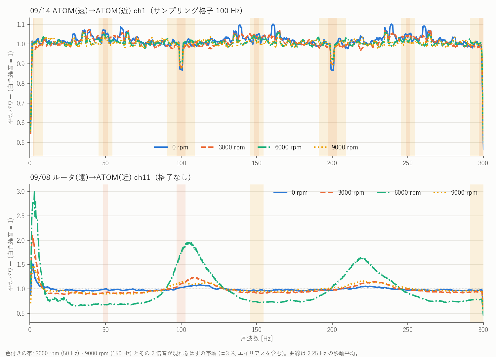
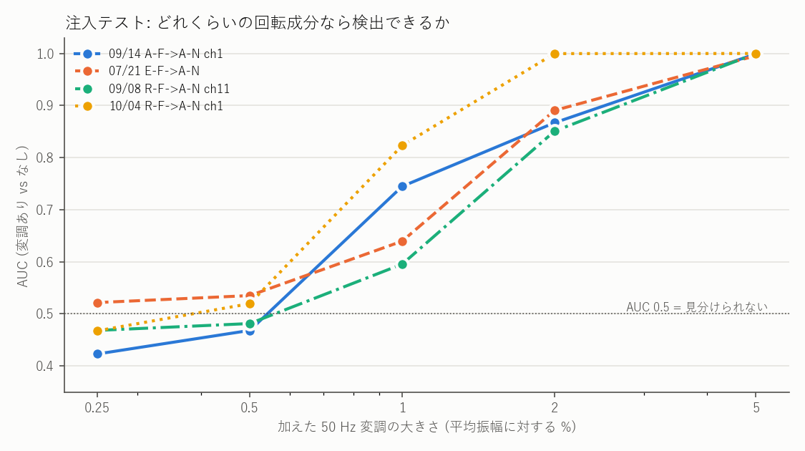
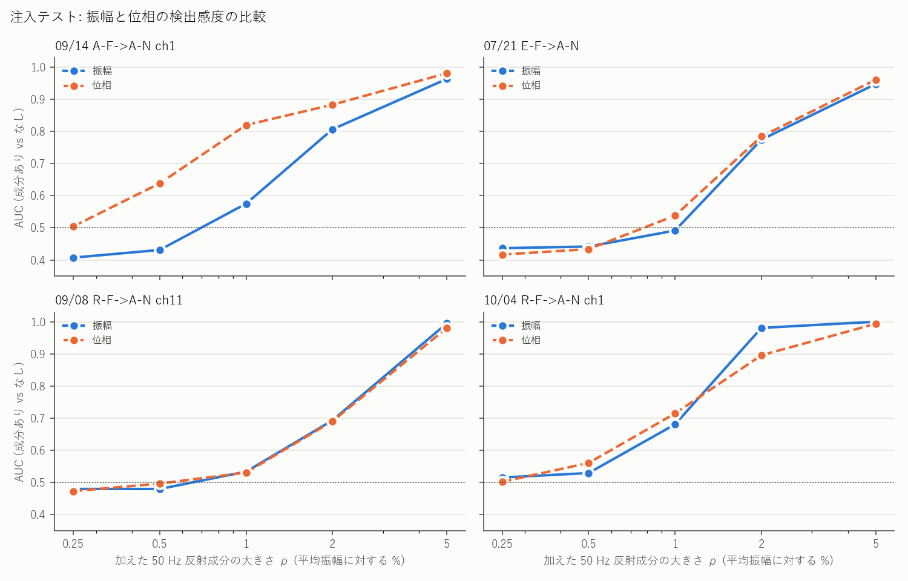
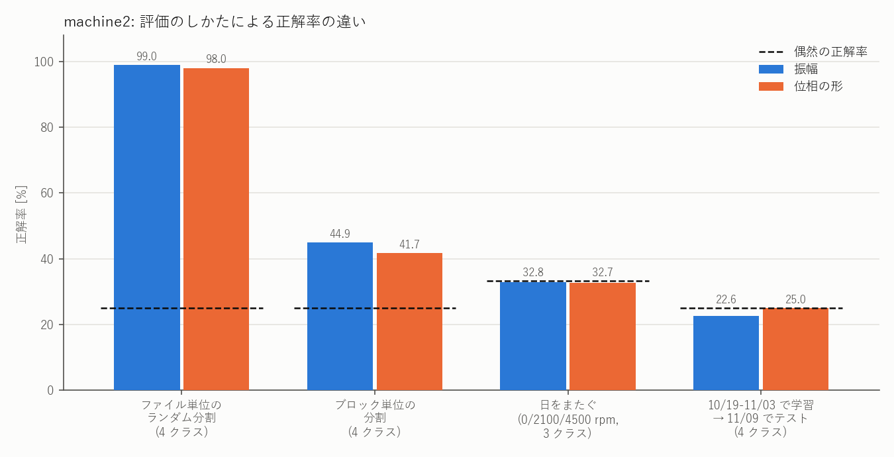
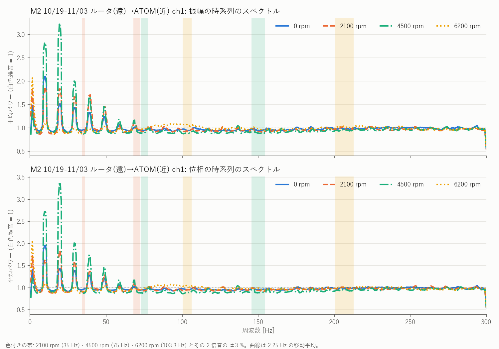

# Wi-Fi CSI による回転数識別の検証 ― これまでの解析のまとめ

作成日: 2026-11-23（10 章「正・負のサブキャリアの検証」を追加）

---

## 目次

1. 概要
2. データと測定条件
3. 技術メモの再現検証
4. ルータ送信における CSI のフレーム形式
5. 日をまたいだ汎化
6. 測定セッションの違いの検証
7. 回転周波数のスペクトル解析
8. 位相を使った解析
9. 別の部屋・別の機械（machine2）での検証
10. 正・負のサブキャリアの検証
11. 総合的な結論と今後の測定への提案
付録 A. 技術メモとの条件別比較
付録 B. 時間ドリフトの対照テストの条件別結果
付録 C. 回転周波数の帯域パワーの条件別結果

---

## 1. 概要

### 1.1 目的

Wi-Fi の CSI（チャネル状態情報）から、工作機械・ドリルの回転数（0〜9000 rpm の 4 クラス）を識別できるかを検証した。出発点は、技術メモ「Wi-Fi CSI による NC 工作機械の回転数識別 測定・解析 技術メモ」（2026 年 8 月）の結果である。技術メモでは、時間平均した CSI 振幅を XGBoost で分類し、多くの条件で 90 % を超える正解率を報告している。

### 1.2 結論

1. **技術メモ第 5 章の主な結果は、生データから再現できた。** 時間平均の効果、直接波除去で精度が下がること、観測時間と精度の関係、ストロボ効果は、いずれも全条件平均で 1 pt 前後の差で再現した。ただし、技術メモ側の処理の誤りと考えられる点が 3 つ見つかった（3 章）。
2. **ルータ送信では、パケットごとに CSI の形式（サブキャリアの並び）が異なる。** 形式の比率は日やセッションによって変わり、回転数と交絡する。ルータの P_dir のばらつきは、形式の比率でほぼ説明できる（r = −0.955）（4 章）。
3. **日をまたぐと、どの配置・どの特徴量でも、正解率は偶然の水準（25 %）まで落ちる**（5 章）。
4. **日内の高い正解率は、回転数ではなく測定セッションの違いでも説明できてしまう。** 同じ回転数の 1 回の測定を時間で 4 つに区切っただけの擬似クラスが、平均 70.9 % 当たった（6 章）。
5. **CSI の振幅・位相の時系列に、回転周波数の成分は検出されなかった。** 平均振幅の 2〜5 % の成分なら検出できる感度があった（7・8 章）。
6. **回転数をブロックごとに入れ替えて測った別の部屋のデータ（machine2）で、上記を直接確かめた。** 同じ回転数・同じ日の別ブロックは 94〜100 % で見分けられた。一方、別の日に測った同じ回転数は当てられず（3 クラスで 32.8 %、偶然は 33.3 %）、同じ日の他のブロックで学習しても偶然より低かった（9 章）。
7. **「ch11 では正、ch1 では負のサブキャリアだけを使うと精度が上がる」という仮説は支持されなかった。** どちらのチャネルでも、半分のサブキャリアだけにすると精度は下がり、有利な側がチャネルで入れ替わる傾向もなかった（10 章）。

**まとめ:** この測定系で「回転数を識別できている」ように見えたのは、測定セッションの違いを見分けていたためである。今のところ、セッションの違いとは別に回転数の情報が CSI に含まれているという証拠は、振幅・位相・スペクトルのどれからも得られていない。

### 1.3 用語

| 用語 | 意味 |
|---|---|
| 条件 | 1 日の 1 つの送受信配置の測定（例: 08/04 ルータ（遠）→ ATOM S3（近））。4 クラス × 約 500 ファイル |
| ファイル | 300 または 500 パケットの CSI。識別の 1 サンプル |
| セッション | 1 回の連続した測定。元の部屋のデータでは、各クラスが 1 回の連続測定（30〜100 分）になっている |
| ブロック | machine2 のデータで、40 ファイルを 1 区切りとした測定の単位（約 7 分） |
| 配置の表記 | 送信機-位置→受信機-位置。R = ルータ、A = ATOM S3、E = アンテナ付き ESP32-S3、N = 近、F = 遠 |
| ランダム分割 | ファイル単位の層化ランダム分割（学習 64 %・検証 16 %・テスト 20 %）。技術メモと同じ評価方法 |
| P_dir | CIR（遅延プロファイル）のピーク ±2 タップに含まれるエネルギーの割合 |

---

## 2. データと測定条件

### 2.1 元の部屋（2214）のデータ（31 条件）

06/18〜10/28 に、送受信機の種類と配置を変えて 31 条件を測定した。機械の回転数は 0 / 3000 / 6000 / 9000 rpm の 4 クラスである。

| 送信 → 受信 | 近→近 | 遠→近 | 遠→遠 |
|---|---|---|---|
| ルータ → ATOM S3 | 06/18, 08/03 | 06/22, 08/04, 09/07, 09/08, 09/10, 10/01, 10/04 | 06/29, 08/06 |
| ルータ → ESP32-S3 | 07/09 | 07/10 | 07/11 |
| ATOM S3 → ATOM S3 | 06/30 | 06/30, 09/14, 09/17, 10/28 | 07/03 |
| ATOM S3 → ESP32-S3 | 07/14 | 07/16 | 07/20 |
| ESP32-S3 → ESP32-S3 | 07/06 | 07/06, 09/24 | 07/07 |
| ESP32-S3 → ATOM S3 | 07/21 | 07/21, 09/28 | 07/27 |

使用チャネル:

| 送信機 | ch1 | ch11 |
|---|---|---|
| ルータ | 08/06 以前のすべて、10/04 | 09/07, 09/08, 09/10, 10/01 |
| ATOM S3・ESP32-S3 | 09/14, 09/17, 09/24, 09/28 | 08/06 以前のすべて、10/28 |

**記録の訂正:**
- 08/06 以前は、フォルダ名にも測定環境の記録にもチャネルの記載がない。研究者の確認により、ルータ送信は ch1、マイコン送信は ch11 とした。
- 07/09・07/10・07/11 の受信機は、フォルダ名と測定環境の記録では ATOM S3 だが、実際にはアンテナ付き ESP32-S3 である（研究者の確認）。
- 08/06 には、元のファイルと中身がまったく同じ重複ファイル（「〜 (1).txt」）が含まれていたので除外した。

### 2.2 別の部屋（2228）のデータ（machine2）

| 項目 | 内容 |
|---|---|
| 期間 | 10/19〜11/03（以下 M2-A）と 11/09（以下 M2-B） |
| 部屋 | 2228（元の部屋 2214 よりかなり広い。大きさは未測定）。M2-B のフォルダ名の末尾は 2214 だが、2228 が正しい |
| 機械 | ドリル（HOZAN K-21） |
| 回転数 | 0 / 2100 / 4500 / 6200 rpm。タコメータで測定しており、表記どおり（M2-A のフォルダ名の「2000rpm」は 2100 rpm） |
| 送受信 | ルータ（遠）→ ATOM S3（近）、ch1 |
| 測定のしかた | モータの過熱を防ぐため、40 ファイルを 1 ブロックとし、回転数を入れ替えながら複数回に分けて測定 |

### 2.3 CSI の取得

受信機（ESP32-S3 系）が出力する CSI は、1 パケットあたり 64 個（列 0〜63）の複素数である。各列が 1 本のサブキャリアに対応する。マイコン送信では、値があるのは列 2〜58 の 57 本である。

パケットの間隔は送信機によって違う。

| 送信機 | パケットの間隔 |
|---|---|
| ATOM S3 | 8 ms（6〜7 月）または 10 ms（9〜10 月） |
| ESP32-S3 | 10 ms |
| ルータ | 約 2 ms 間隔のバーストと、約 1 s の休止の繰り返し |

---

## 3. 技術メモの再現検証

### 3.1 方法

技術メモの記述に従って処理を組み直し、独立に再実装した。対象は技術メモと同じ 06/18〜08/04 の 20 条件である。

| 項目 | 処理 |
|---|---|
| 特徴量 | 有効 57 サブキャリア（列 2〜58）の振幅 |
| 時間平均 | ファイル内の全パケットについて、サブキャリアごとに振幅を平均（57 次元） |
| 直接波除去 | CSI を IFFT して CIR を求め、ピークから n タップを巡回的にゼロにして FFT で戻す |
| 分類器 | XGBoost（multi:softmax、最大 300 ラウンド、早期終了 30） |
| 評価 | ランダム分割、乱数シード 3 通りの平均 |

### 3.2 主な結果

| 項目 | 技術メモ | 再現 |
|---|---|---|
| 全パケット連結（20 条件の平均） | 74.32 % | 73.38 % |
| 時間平均（20 条件の平均） | 94.70 % | 94.05 % |
| 時間平均で改善した条件数 | 20 / 20 | 20 / 20 |
| 最良条件（08/04 R-F→A-N） | 99.58 % | 99.75 % |

**直接波除去（20 条件の平均, %）:**

| 除去タップ数 | 0 | 1 | 2 | 3 | 5 | 7 |
|---|---|---|---|---|---|---|
| 技術メモ | 94.70 | 93.16 | 89.79 | 88.58 | 87.58 | 85.93 |
| 再現 | 94.05 | 92.17 | 88.49 | 87.54 | 86.44 | 84.52 |

**観測時間（20 条件の平均, %）:**

| 観測時間 [s] | 0.05 | 0.1 | 0.2 | 0.5 | 1.0 | 1.5 | 2.0 |
|---|---|---|---|---|---|---|---|
| 技術メモ | 73.2 | 78.2 | 83.0 | 88.1 | 90.8 | 92.4 | 93.4 |
| 再現 | 72.7 | 77.1 | 82.1 | 87.5 | 90.5 | 91.9 | 92.7 |

- 時間平均は全パケット連結より大幅に高い。
- 直接波除去は、除去するタップ数を増やすほど精度が単調に下がる。
- 観測時間を延ばすと精度は上がる。短時間ではルータ送信が有利（0.05 s でルータ 84.1 %、ATOM S3 68.7 %）。
- ESP32-S3 → ESP32-S3 の構成だけ、6000 rpm の再現率が 60.4 % に下がる（ストロボ効果。パケットレート 99.1 Hz に対して 6000 rpm = 100 Hz が 0.9 Hz に折り返される）。

マイコン送信の 12 条件では、P_dir と、直接波除去で失われる CIR エネルギーが、技術メモと小数第 1 位までほぼ一致した。

### 3.3 技術メモ側の処理の誤りと考えられる点

**(1) 06/18・06/22 のデータの読み込みが 1 列ずれている。** この 2 日のファイルだけ、1 行が「timestamp + 128 値」の 129 列で、他の日にあるインデックス列がない。他の日と同じ 130 列として読むと、(虚部, 実部) の組がサブキャリアをまたいでずれる。わざとずらして計算すると技術メモの値が再現される。

| 06/18 R-N→A-N | 時間平均 | 1 タップ除去 | 3 タップ除去 | 7 タップ除去 |
|---|---|---|---|---|
| 正しく読んだ場合 | 96.42 | 78.58 | 83.00 | 82.67 |
| 1 列ずらした場合 | 97.08 | 88.33 | 91.33 | 88.25 |
| 技術メモ | 96.75 | 88.92 | 91.75 | 88.75 |

時間平均の精度はほとんど変わらないが、直接波除去後の精度は正しく読むと 5〜10 pt 下がる。

**(2) 付録 A の P_dir（ルータ条件）が付録 B と矛盾する。** 定義上、P_dir は「5 タップ除去で失われるエネルギー」と同じ値になる。マイコン送信の条件ではこの関係が成り立つが、ルータ条件では成り立たない（例: 06/18 は付録 A で 95.6 %、付録 B で 67.1 %、再現値は 29.2 %）。技術メモ 5.3 節の P_dir と改善量の相関（r = −0.335）はこの値に依存している。再現値では r = 0.049 で、「有意な相関はない」という結論自体は変わらない。

**(3) ルータ送信では、フレーム形式の混在が回転数と交絡している。** 詳しくは 4 章で述べる。

---

## 4. ルータ送信における CSI のフレーム形式

### 4.1 形式の違い

ルータ送信の CSI を調べると、サブキャリアの並びが異なる形式が少なくとも 4 種類あった。

| 形式 | 特徴 |
|---|---|
| **S**（標準） | 列 2〜58 に値がある。周波数の低い順に並ぶ。マイコン送信と同じ形式 |
| **D** | S と同じ並びで、列 0 に 100〜160 程度の大きな値がある（通常の値は 20 以下） |
| **W** | 列 30〜34 付近がすべて 0。帯域端の 0 が配列の中央に来る、並び順が巡回した形式（FFT の出力順） |
| **WD** | W と同じ並びで、列 0 に大きな値がある |

```
S 形式: 低い周波数 → 高い周波数 の順
 列:     0  1 | 2 ............ 30 ............ 58 | 59 ... 63
 周波数:  0    | −28 ........... 0 付近 ......... +28 | 0

W 形式: 0 → 正の周波数 → 負の周波数 の順
 列:     0 | 1 ....... 28 | 29〜35 付近 | 36 ....... 63
 周波数:    | +1 ...... +28 | 0（帯域端）| −28 ...... −1
```

同じ「列 10」でも、S 形式と W 形式では別の周波数のサブキャリアを指す。そのため、全パケットの列 2〜58 をそのまま特徴量にすると、形式が混ざったときに別の周波数の値を同じ特徴量として扱うことになる。

### 4.2 形式が変わる原因（推測）

受信機の CSI の並びは、受信したフレームの種類（non-HT / HT、帯域幅 20/40 MHz、セカンダリチャネルの有無など）で変わる。S 形式と W 形式の違いは、受信機が 40 MHz の格子で受けたか（セカンダリチャネルあり）、20 MHz で受けたか（なし）の違いとよく合う。ルータは周囲の電波の状況に応じて帯域幅を自動で切り替えるので、これが形式の混在の原因と考えられる。

全条件のチャネルが分かったので確かめたところ、形式はチャネルでは決まっていなかった。同じ ch1 でも、ほぼ S 形式の日（07/10, 08/06）、ほぼ D 形式の日（07/09）、ほぼ W 形式の日（07/11, 10/04）がある。

なお、受信機のファームウェアは HT-LTF だけを取得する設定（`htltf_en = true`）だが、次の理由から、HT-LTF だけから CSI を取っているとは言い切れない。

1. non-HT フレーム（ビーコンなど）には HT-LTF がない。
2. `ltf_merge_en = true` のため、HT フレームでは L-LTF と HT-LTF を平均した値が出力される。
3. 送信元の MAC アドレスだけで選別しているので、ping の応答以外のフレームも含まれる。
4. CSI バッファの長さに関係なく、先頭 128 バイトを決め打ちで読んでいる。

ファームウェアはタイムスタンプと CSI の値しか出力していないので、各形式がどのフレーム種別に当たるかは、今のデータからは特定できない。

### 4.3 形式と回転数の交絡

形式の比率は、クラス（＝測定セッション）ごとに大きく違った。

| 条件 | 0 rpm | 3000 rpm | 6000 rpm | 9000 rpm |
|---|---|---|---|---|
| 06/18 R-N→A-N | D 90 % | D 97 % | WD 97 % | WD 99 % |
| 06/22 R-F→A-N | WD 88 % | D 90 % | D 98 % | D 93 % |
| 08/03 R-N→A-N | S 52 % | S 65 % | S 77 % | S 99 % |
| 09/08 R-F→A-N ch11 | S 51 % | S 95 % | S 100 % | D 72 % |

形式の比率（4 次元）だけを特徴量にすると、ルータ 14 条件で 32〜81 % の正解率になった（偶然は 25 %）。**交絡はある。**

ただし、1 つの形式のパケットだけで時間平均を作っても、日内のランダム分割ではほぼ同じ正解率が出た（例: 08/04 S 形式のみ 99.4 %、09/08 D 形式のみ 99.5 %）。したがって、日内の高い正解率は、形式の違いだけで説明できるものではない。一方で、これは「形式という要因を除いても」高いことを示すだけで、測定セッションの違いという要因は除けていない（6 章・9 章）。

### 4.4 P_dir のばらつきの原因

ルータ送信の P_dir は、日によって 26〜93 % と大きくばらつく。これは、列 0 に大きな値をもつ形式（D・WD）の比率でほぼ説明できた。

- ルータ 14 条件で、D+WD 形式の比率と P_dir の相関は **r = −0.955（p = 1×10⁻⁷）**。
- 列 0 に大きな値をもたない形式（S・W）のパケットだけで計算すると、ルータでも 14 条件中 12 条件で P_dir が 83 % 以上になり、マイコン送信（90〜96 %）に近づく。
- 列 0 の突出した値は、IFFT すると全タップに均等に広がる。そのため、ピーク付近のエネルギーの割合（P_dir）が下がる。

ルータ条件の P_dir、直接波除去の結果、およびそれに基づく考察は、形式をそろえて計算し直す必要がある。

---

## 5. 日をまたいだ汎化

### 5.1 方法

同じ送受信配置を別の日に測った条件をグループにまとめた。

| グループ | 日数 | 日付 |
|---|---|---|
| R-F→A-N | 7 | 06/22, 08/04, 09/07, 09/08, 09/10, 10/01, 10/04 |
| A-F→A-N | 4 | 06/30, 09/14, 09/17, 10/28 |
| R-N→A-N | 2 | 06/18, 08/03 |
| R-F→A-F | 2 | 06/29, 08/06 |
| E-F→E-N | 2 | 07/06, 09/24 |
| E-F→A-N | 2 | 07/21, 09/28 |

- **ペア:** ある 1 日で学習し、同じグループの別の 1 日でテストする。
- **leave-one-day-out:** グループ内の他の日すべてで学習し、残した 1 日でテストする（3 日以上あるグループ）。

特徴量は、振幅の時間平均（raw）、それをファイル内の平均で割ったもの（norm、ゲインの違いを除く）、時間方向の標準偏差 ÷ 平均（cv、時間変動の大きさ）である。

### 5.2 結果

**leave-one-day-out（%、偶然は 25 %）:**

| テストした日 | raw | norm | cv |
|---|---|---|---|
| 06/22 R-F→A-N | 19.1 | 26.5 | 32.2 |
| 08/04 R-F→A-N | 29.7 | 28.8 | 24.8 |
| 09/07 R-F→A-N ch11 | 24.5 | 25.6 | 28.3 |
| 09/08 R-F→A-N ch11 | 17.2 | 19.1 | 23.4 |
| 09/10 R-F→A-N ch11 | 22.7 | 18.3 | 19.0 |
| 10/01 R-F→A-N ch11 | 22.8 | 17.9 | 37.2 |
| 10/04 R-F→A-N ch1 | 25.6 | 18.7 | 27.4 |
| 06/30 A-F→A-N | 29.0 | 25.0 | 25.0 |
| 09/14 A-F→A-N ch1 | 23.7 | 25.0 | 18.8 |
| 09/17 A-F→A-N ch1 | 39.8 | 25.0 | 23.1 |
| 10/28 A-F→A-N ch11 | 39.9 | 25.0 | 16.1 |
| **平均** | **26.7** | **23.2** | **25.0** |

**ペア（グループごとの平均, %）:**

| グループ | ペア数 | raw | norm | cv |
|---|---|---|---|---|
| R-F→A-N | 42 | 25.5 | 25.2 | 25.1 |
| A-F→A-N | 12 | 29.1 | 24.7 | 24.1 |
| R-N→A-N | 2 | 27.2 | 25.1 | 24.3 |
| R-F→A-F | 2 | 25.4 | 20.2 | 24.6 |
| E-F→E-N | 2 | 25.0 | 24.8 | 25.0 |
| E-F→A-N | 2 | 25.0 | 37.6 | 24.2 |

### 5.3 読み取れること

- **すべてのグループ・特徴量で、正解率は偶然の水準だった。** 学習に使う日を 6 日に増やしても改善しない。
- 予測は、テストした日のファイルのほとんどが 1〜2 クラスに偏った（例: 06/30 は全ファイルを 3000 rpm と予測）。日の違いによる特徴量のずれが、クラスの違いよりずっと大きい。
- フレーム形式の混在がないマイコン送信でも同じなので、原因はフレーム形式ではない。
- **チャネルをそろえても変わらない。** 同じチャネルの日どうしのペアは平均 26.9 %、違うチャネルどうしは 25.7 %（raw）。同じ配置・同じチャネルの日だけで leave-one-day-out をしても、平均 30.0 %（raw）、24.9 %（norm）だった。

---

## 6. 測定セッションの違いの検証

### 6.1 問題の所在

元の部屋の 31 条件では、各クラスのファイルは 1 回の連続測定（30〜100 分）を時間順に区切ったものである。ファイルの間隔はほぼ 10 ms で、クラス内に 10 s を超える空きはほとんどない。つまり、1 つの回転数は 1 回の連続測定にまとまっていて、**回転数の違いと測定セッション（時間帯）の違いが、データの上で完全に重なっている。**

技術メモの評価（ランダム分割）では、学習側とテスト側のファイルが時間的に隣り合う。そのため、回転数ではなく「その時間帯の CSI の特徴」を手がかりにしても当たってしまう可能性がある。

### 6.2 方法

全 31 条件で、振幅の時間平均（57 次元）を使って次の 3 つを比べた。

| 名前 | 内容 | 意味 |
|---|---|---|
| ランダム分割 | 回転数 4 クラス、ファイル単位のランダム分割 | 技術メモと同じ評価 |
| 時間方向の分割 | 回転数 4 クラス。各クラスの時間的に前の 64 % で学習、次の 16 % で早期終了、最後の 20 % でテスト | 時間的に離れたファイルでも当たるか |
| 時間ブロックの対照 | 同じ回転数の 1 回の測定を時間順に 4 等分して擬似クラスにし、ランダム分割で識別 | 回転数は同じなので、当たるとすれば時間変化だけによる |

### 6.3 結果

| 送信機 | 条件数 | ランダム分割 | 時間方向の分割 | 時間ブロックの対照 |
|---|---|---|---|---|
| ルータ | 14 | 95.8 | 71.0 | 78.1 |
| ATOM S3 | 9 | 97.2 | 87.1 | 66.8 |
| ESP32-S3 | 8 | 92.1 | 73.7 | 62.9 |
| **全 31 条件** | 31 | **95.2** | **76.3** | **70.9** |

（%。偶然は 25 %。条件ごとの値は付録 B）

- **回転数が同じでも、時間帯が違うだけでファイルを見分けられる**（時間ブロックの対照で平均 70.9 %、最大 90.8 %）。CSI の時間平均は、1 回の測定の中でもゆっくり変化している。
- 回転数のクラスどうしは別の時間帯に測っているので、その隔たりは時間ブロックどうしより大きい。**回転数の情報がまったくなくても、ランダム分割で 70〜90 % の正解率が出てもおかしくない。**
- 時間的に離れたファイルでテストすると、31 条件中 12 条件で 70 % 未満になり、13 条件で 20 pt 以上下がった。
- 7 条件では、時間方向の分割でも 90 % 以上を保った。ただし、その違いが回転数によるものか、セッションごとに一定の別の要因によるものかは、このデータでは区別できない。

### 6.4 ゲインの影響ではない

受信機のファームウェアは、測定開始直後の 100 パケットの平均で受信ゲインを固定する。もしクラスごとに起動し直していれば、クラスごとにゲインが違い、振幅の水準だけで当てられてしまう。そこで、振幅をファイル内の平均で割った特徴量（norm）でも評価した。

| 特徴量 | ランダム分割 | 時間方向の分割 |
|---|---|---|
| 振幅の時間平均 | 95.2 | 76.3 |
| ファイル内の平均で割ったもの | 94.7 | 75.1 |
| 時間方向の標準偏差 ÷ 平均 | 75.4 | 61.0 |

norm でもほとんど変わらない。セッションごとに違うのは、振幅全体の水準ではなく、**サブキャリアごとの振幅の形（周波数特性）**である。

---

## 7. 回転周波数のスペクトル解析

### 7.1 目的と方法

セッションの違いでは説明できない、回転数に物理的に結びついた証拠があるかを確かめるため、CSI 振幅の時系列のスペクトルに回転周波数の成分があるかを調べた。

| 回転数 | 回転周波数 | 2 倍音 |
|---|---|---|
| 3000 rpm | 50 Hz | 100 Hz |
| 6000 rpm | 100 Hz | 200 Hz |
| 9000 rpm | 150 Hz | 300 Hz |

パケットの受信時刻は不等間隔なので、受信時刻そのものを使った DFT でパワースペクトルを求めた（白色雑音なら 1）。回転周波数と 2 倍音の ±3 % を「期待帯域」とし、その中の最大値を、回転数のクラスと 0 rpm のクラスで比べた（AUC。0.5 なら差がない）。帯域を 5〜45 Hz ずらした場所でも同じ比較をして、期待帯域だけが特別に大きいかを確かめた。

### 7.2 サンプリングの格子と折り返し

マイコン送信では、受信時刻がほぼ 10 ms（または 8 ms）の格子に乗っている。そのため、格子の半分（50 Hz または 62.5 Hz）を超える周波数は折り返される。

| 送信機 | 格子 | 回転周波数の現れる位置 |
|---|---|---|
| ATOM S3（6〜7 月） | 125 Hz | 3000 → 50 Hz、6000 → 25 Hz、9000 → 25 Hz |
| ATOM S3（9〜10 月）・ESP32-S3 | 100 Hz | 3000 → 50 Hz、**6000 → 0 Hz**、9000 → 50 Hz |
| ルータ | なし | 50 / 100 / 150 Hz のまま |

100 Hz 格子では、3000 rpm と 9000 rpm が同じ 50 Hz に重なり、6000 rpm は 0 Hz に重なってゆっくりした変化と区別できない。

### 7.3 結果



| 指標 | 値 |
|---|---|
| AUC の中央値（82 通り） | 0.51（四分位範囲 0.46〜0.57） |
| AUC ≥ 0.7 かつ、帯域をずらした場合の 95 パーセンタイル以上 | 1 通り（06/18 の 9000 rpm。形式の交絡が強い条件） |
| 帯域パワー 3 次元での識別（日内ランダム分割） | 平均 33.9 % |
| 同（日をまたいだ leave-one-day-out） | 平均 28.8 % |

**回転周波数の成分は検出されなかった。**

### 7.4 感度の確認（注入テスト）

0 rpm のファイルに、回転周波数で周期的に変わる人工の成分を加え、どれだけ小さい成分まで検出できるかを調べた。



平均振幅の **2 % の変調で AUC 0.82〜1.00、5 % でほぼ 1.00** になった。自然な振幅の揺らぎ（6〜11 %）よりずっと小さい成分でも検出できる。回転数はタコメータで確認されているので、実際の回転数が期待帯域から外れていた可能性もない。したがって、**回転周波数で周期的に変わる成分は、少なくとも振幅の数 % より小さい。**

### 7.5 ルータ送信の 103〜112 Hz 付近の成分

ルータ送信では、103〜112 Hz 付近に幅の広い山が現れることがある。しかし、0 rpm（停止中）にも同じ強さで現れる日があり（06/18、08/06 など）、回転によるものではない。ファイル内の形式の割合と関係があり、ルータの送信の仕方に由来すると考えられる。

---

## 8. 位相を使った解析

### 8.1 位相の補正

ESP32 の CSI の位相には、パケットごとにランダムなずれ（全サブキャリア共通のずれと、サブキャリア番号に比例するずれ）が乗る。隣り合うサブキャリアの積から傾きを求めて除き、続いて共通のずれを除いた。補正後の位相の時間方向の揺らぎは、マイコン送信で約 0.05 rad と安定していた（ルータ送信は 0.03〜0.37 rad）。

### 8.2 結果

| 評価 | 位相の形 | （参考）振幅 |
|---|---|---|
| 日内ランダム分割 | 91.7 | 95.2 |
| 日内の時間方向の分割 | 75.9 | 76.5 |
| 時間ブロックの対照 | 63.7 | 70.8 |
| 日をまたいだ leave-one-day-out | 28.9 | 25.3 |
| 位相の時系列の回転周波数の帯域（AUC の中央値） | 0.52 | 0.51 |

（%。振幅と位相を組み合わせても、日をまたぐと 31.1 %）

- **位相の形も、振幅と同じくセッションごとに違う。** ランダム分割では高く、時間的に離れると下がり、回転数が同じでも時間区間を見分けられる。
- 日をまたぐと偶然の水準で、40 % を超えたのは 11 通り中 3 通りだけ（特徴量によって当たる日が入れ替わる）。
- 位相の時系列にも、回転周波数の成分は見つからなかった。

### 8.3 感度の比較

回転によって周期的に強さが変わる反射経路の成分を CSI に加えて、振幅と位相の感度を比べた。



位相が安定している ATOM 送信では、位相のほうが振幅の半分程度の成分まで検出できた（反射成分 1 % で AUC 0.82、振幅は 0.58）。他の条件では同程度で、どちらも 5 % ならほぼ確実に検出できる。それでも実データに成分が見つからないので、**回転による周期的な反射成分は、少なくとも直接波の数 % より小さい。**

---

## 9. 別の部屋・別の機械（machine2）での検証

### 9.1 このデータの意味

machine2 のデータは、回転数を入れ替えながらブロックに分けて測っている。特に M2-A では、0・2100・4500 rpm を同じ 5 日（10/19、10/22、10/26、10/27、11/01）に測っている。これによって、元の部屋のデータではできなかった「別の日に測った同じ回転数を当てられるか」「同じ日の別のブロックで学習すれば当てられるか」を直接確かめられる。

| クラス | M2-A の測定日（各 10 ブロック） | M2-B |
|---|---|---|
| 0 rpm | 10/19（3）、10/22、10/26（3）、10/27、11/01（2） | 11/09（2 ブロック） |
| 2100 rpm | 10/19（3）、10/22、10/26（2）、10/27（2）、11/01（2） | 11/09（2） |
| 4500 rpm | 10/19（2）、10/22（2）、10/26（2）、10/27（2）、11/01（2） | 11/09（2） |
| 6200 rpm | 11/02（4）、11/03（6） | 11/09（2） |

（括弧内はその日のブロック数）

6200 rpm だけは、M2-A で他のクラスを測っていない日に測られている。

### 9.2 識別の結果



| 評価 | 偶然 | 振幅 | 位相の形 |
|---|---|---|---|
| ファイル単位のランダム分割（4 クラス） | 25 | 99.0 | 98.0 |
| ブロック単位の分割（4 クラス） | 25 | 44.9 | 41.7 |
| 日をまたぐ（0/2100/4500 rpm、3 クラス） | 33.3 | **32.8** | **32.7** |
| M2-A で学習 → M2-B でテスト（4 クラス） | 25 | 22.6 | 25.0 |
| 同じ回転数・同じ日のブロックどうしの識別（対照） | 17〜50 | 94〜100 | 94〜100 |

**同じ日の中での leave-one-block-out:** 同じ日の他のブロック（別の回転数のブロックも含む）で学習し、残した 1 ブロックをテストした。学習とテストが同じ日なので、日ごとの設置のずれの影響を受けない、最も有利な条件での評価である。

| 日 | クラス | 偶然 | 振幅 | 位相の形 |
|---|---|---|---|---|
| 10/19 | 0/2100/4500 | 33.3 | 3.3 | 0.7 |
| 10/22 | 0/2100/4500 | 33.3 | 2.1 | 0.0 |
| 10/26 | 0/2100/4500 | 33.3 | 14.5 | 28.6 |
| 10/27 | 0/2100/4500 | 33.3 | 40.6 | 21.2 |
| 11/01 | 0/2100/4500 | 33.3 | 20.3 | 13.2 |
| 11/09 | 4 クラス | 25.0 | 18.8 | 11.7 |

### 9.3 読み取れること

- **同じ回転数・同じ日でも、ブロックが違えば 94〜100 % で見分けられる。** 約 7 分の測定 1 回分の違いがあるだけで、CSI の時間平均の形はほぼ確実に区別できるほど変わる。
- **別の日に測った同じ回転数は当てられない**（3 クラスで 32.8 %、偶然 33.3 %）。同じ部屋・同じ機械で日だけが違う M2-B でも同じだった。
- **同じ日の他のブロックで学習しても、正解率は偶然より大きく低い。** 35 ブロック中 27 ブロックが 0〜12 % だった。テストしたブロックは、同じ回転数の別ブロックより、同じ日の別の回転数のブロックに似ていると判定される。CSI の時間平均の形は、回転数ではなくセッション（測定の時間帯、ルータの状態）で決まっている。
- ブロック単位の分割で 6200 rpm だけが当たった（再現率 87 %）のは、6200 rpm だけが別の日に測られ、全ブロックが W・WD 形式だからである。形式の比率だけでも再現率は 74 % になり、M2-B の 6200 rpm には当てはまらなかった。

### 9.4 スペクトル



- 回転周波数（2100 rpm = 35 Hz、4500 rpm = 75 Hz、6200 rpm = 103.3 Hz）の帯域で、同じ日の 0 rpm と比べた AUC は 0.35〜0.77 とばらつき、一貫した傾向はなかった。2000 rpm（33.3 Hz）の帯域でも同じだった。
- 6200 rpm は 103 Hz 付近がやや高いが、細い線ではなく、W・WD 形式のブロックだけで比べると他の回転数と有意な差はなかった（p = 0.12）。
- 2100・4500 rpm では、平均振幅の 2 % の成分で AUC 0.9 前後になる感度があった。
- このデータには、**ルータのビーコン間隔（102.4 ms = 9.77 Hz）の倍音**（9.75、19.5、29.25、39.0 Hz …）がはっきり出ていた。0 rpm にも出るので回転とは関係ないが、強さが測定日によって大きく違い（6200 rpm の日にはほとんど出ない）、セッションの違いの一因になっている。

### 9.5 machine2 のフレーム形式

形式はブロックごとに大きく変わり、同じ日・同じ回転数でもブロックによって違った（例: 0 rpm 10/19 のブロック 1 は W・WD、ブロック 3 は S・D）。ルータがブロック（接続）ごとに送り方を切り替えていると考えられる。

---

## 10. 正・負のサブキャリアの検証

### 10.1 背景と仮説

他の研究員から、「ch11 のデータで正のサブキャリアだけを使うと、識別精度が上がった」という報告があった。ここで正・負は、それぞれのチャネルの中心周波数より周波数が高い側・低い側を指す。2.4 GHz 帯では、ch11（2462 MHz）は下側に ch7〜10、ch1（2412 MHz）は上側に ch2〜5 の重なるチャネルがある。隣のチャネルからの干渉を避けるという考え方に立つと、**ch1 では負（周波数の低い側）のサブキャリアだけを使うと精度が上がる**のではないか、という仮説が立つ。これを検証した。

### 10.2 方法

- 振幅の時間平均を、全サブキャリア（57 本）、負だけ（k = −28〜−1、S 形式の列 2〜29）、正だけ（k = 1〜28、S 形式の列 31〜58）の 3 通りにして比べた。
- ch1 は 14 条件（ルータ 10、マイコン 4）、ch11 は 17 条件（ルータ 4、マイコン 13）。machine2（ch1）でも比べた。
- 評価は、ランダム分割、時間方向の分割、日をまたぐ評価（同じ配置・同じチャネルの別の日）、machine2 の日をまたぐ評価と同じ日の中での leave-one-block-out。

**列番号との対応についての注意:** 上の対応は、S 形式では列番号が大きいほど周波数が高い、という解釈による。S 形式と W 形式が同じファイルに混ざっている例が少なく、CIR の因果性（反射波は直接波より後に届く）を使う方法でも判定できなかったので、この向きはデータからは確かめられていない。向きが逆なら「負」と「正」が入れ替わるので、結果には列番号も併記した。

### 10.3 結果

**チャネルごとの平均（%）:**

| 評価 | チャネル | 全サブキャリア | 負だけ（列 2〜29） | 正だけ（列 31〜58） |
|---|---|---|---|---|
| ランダム分割 | ch1 | 96.0 | 90.7 | 92.2 |
| ランダム分割 | ch11 | 95.2 | 90.5 | 90.6 |
| 時間方向の分割 | ch1 | 69.8 | 68.9 | 65.6 |
| 時間方向の分割 | ch11 | 80.8 | 76.3 | 75.0 |
| 日をまたぐ（偶然 25 %） | ch1 | 24.2 | 27.6 | 23.1 |
| 日をまたぐ（偶然 25 %） | ch11 | 27.5 | 26.6 | 24.9 |

**machine2（ch1）（%）:**

| 評価 | 偶然 | 全サブキャリア | 負だけ | 正だけ |
|---|---|---|---|---|
| ファイル単位のランダム分割（4 クラス） | 25 | 99.0 | 98.1 | 98.0 |
| 日をまたぐ（0/2100/4500 rpm, 3 クラス） | 33.3 | 32.8 | 34.7 | 31.4 |
| 10/19〜11/03 で学習 → 11/09 でテスト | 25 | 22.6 | 31.1 | 20.5 |

- **ランダム分割では、どちらのチャネルでも、どちらの側でも、半分だけにすると精度が下がった**（平均 4〜5 pt）。全サブキャリアより高くなったのは、62 通りの比較のうち 1 通りだけだった。
- **有利な側がチャネルで入れ替わる傾向はなかった。** ランダム分割の「負 − 正」は ch1 で −1.6 pt、ch11 で −0.2 pt で、どちらも有意ではない（p = 0.86、0.89）。
- ch1 の負側は、時間方向の分割と日をまたぐ評価で全サブキャリアとほぼ同じか少し高かったが、有意ではなく、偶然の水準を大きく上回るものでもない。machine2 でも、負側は偶然の水準の近くにとどまった。
- 列番号と周波数の向きが逆だったとしても、半分だけで精度が上がる側はないので、結論は変わらない。

**干渉の手がかり:** 各側のサブキャリアの振幅の時間的な揺らぎ（変動係数）を比べると、ch1 では列 2〜29 の側、ch11 では列 31〜58 の側が大きかった（どちらも p ≈ 0.05）。揺らぎやすい側がチャネルで入れ替わる点は干渉の考え方と合う。ただし、列が大きいほど周波数が高いとすると揺らぎが大きいのは重なるチャネルがない外側になり、干渉の考え方とは逆になる。向きが確かめられないので、どちらとも言えない。いずれにしても、揺らぎが小さい側だけを使っても精度は上がらなかった。

### 10.4 考察

- 回転数の識別に効いている（ように見える）のは 57 本全体の振幅の形で、情報はどのサブキャリアにも分散している。半分を捨てると、その情報も減る。
- 干渉による揺らぎは、300〜500 パケットの時間平均でほとんど消える。
- 他の研究員の結果と食い違う理由として、中心周波数より高い側をどの列と対応させたか（使った列の範囲）、比べた相手（全サブキャリアか負側か）、評価方法（ランダム分割の正解率はセッションの違いでも上がる）、データや分類器の設定の違いが考えられる。比べるには、これらを確認する必要がある。

## 11. 総合的な結論と今後の測定への提案

### 11.1 結論

| 確かめたこと | 結果 | 根拠 |
|---|---|---|
| 技術メモの結果は再現できるか | 再現できる（処理の誤り 3 点を除く） | 3 章 |
| 同じ回転数でも、セッションが違えば見分けられるか | 見分けられる | 6 章（元の部屋 70.9 %）、9 章（machine2 94〜100 %） |
| 別の日に測った同じ回転数を当てられるか | 当てられない | 5 章（約 25 %）、9 章（32.8 %、偶然 33.3 %） |
| 同じ日の別のブロックで学習すれば当てられるか | 当てられない（偶然より低い） | 9 章 |
| 回転周波数の成分が振幅・位相にあるか | ない（数 % の成分なら検出できる感度で） | 7・8・9 章 |
| ch1 で負、ch11 で正のサブキャリアだけを使うと精度が上がるか | 上がらない（半分だけにすると下がる） | 10 章 |

**この測定系では、CSI の時間平均の形はセッションごとに大きく変わり、その変化は回転数による変化よりずっと大きい。** 技術メモの高い正解率は、測定セッションの違いを見分けた結果と考えられる。今のところ、セッションの違いとは別に回転数の情報が CSI に含まれているという証拠は得られていない。

ただし、「回転数の情報がまったくない」と証明されたわけではない。回転による変化が、セッションによる変化に比べて小さすぎて、今の測定・解析では見えていない可能性がある。

### 11.2 セッションの違いの原因の候補

1. **ルータのフレーム形式の切り替わり**（4 章、9.5 節）
2. **ビーコンの影響の強さの変化**（9.4 節）
3. 部屋の中の人や物の位置、温度などの環境の変化

1 と 2 はルータを送信機に使うことによるもので、マイコンを送信機にすれば取り除ける。ただし、元の部屋のマイコン送信でも時間ブロックの対照は 63〜67 % だったので、3 の環境の変化も無視できない。

### 11.3 今後の測定への提案

1. **回転数を入れ替えながらブロックに分けて測る（machine2 のやり方）を続ける。** 現在、元の部屋（2214）で、ルータ送信・ATOM S3 受信・遠→近の配置で、同じやり方で測定中である。データがそろい次第、machine2 と同じ検証を行う。
2. **同じ日にすべての回転数を測る。** machine2 では 6200 rpm だけが別の日に測られ、測定日と区別できなかった。
3. **各ブロックの開始時刻・終了時刻と測定順、受信機の再起動の有無を記録する。** 測定環境の記録のこれらの欄は、現在すべて空欄である。時間的に近いブロックどうしが似ているかを確かめられる。
4. **マイコン送信でも、回転数を入れ替えるブロック測定を行う。** ルータ特有の変動（形式の切り替わり、ビーコン）を除いても、セッションの違いが残るかを確かめられる。その場合、送信間隔を回転周波数と整数比にならない値にするか、ばらつかせると、回転周波数をスペクトルで直接見られる。
5. **受信フレームの情報を記録する。** 受信機のファームウェアの出力に、フレームの種類（`sig_mode`）、帯域幅（`cwb`）、セカンダリチャネル、RSSI、CSI の長さを加えれば、形式の正体が分かり、解析時に確実に選別できる。
6. **評価は日またはブロック単位で分ける。** ファイル単位のランダム分割の正解率は、回転数の識別性能の根拠にならない。
7. 回転部を送受信の経路（第 1 フレネルゾーン）の中に置くなど、回転による変化が大きくなる配置を検討する。
8. 配置の実測値（距離、位置関係の写真）と、測定中の環境（人の出入りなど）を記録する。

---

## 付録 A. 技術メモとの条件別比較

### A-1 除去タップ数ごとの正解率（%、再現 / 技術メモ）

| 条件 | 0 タップ | 1 タップ | 3 タップ | 7 タップ | 全パケット連結（再現） |
|---|---|---|---|---|---|
| 06/18 R-N→A-N | 96.42 / 96.75 | 78.58 / 88.92 | 83.00 / 91.75 | 82.67 / 88.75 | 76.50 |
| 06/22 R-F→A-N | 95.67 / 96.08 | 87.17 / 94.00 | 85.17 / 93.25 | 86.00 / 92.17 | 82.25 |
| 06/29 R-F→A-F | 92.25 / 93.50 | 92.92 / 92.92 | 94.17 / 94.83 | 91.58 / 94.25 | 82.58 |
| 06/30 A-N→A-N | 99.00 / 99.17 | 99.17 / 99.00 | 91.33 / 91.08 | 85.75 / 85.83 | 76.50 |
| 06/30 A-F→A-N | 90.42 / 92.00 | 90.42 / 90.17 | 73.08 / 73.25 | 62.08 / 66.42 | 54.42 |
| 07/03 A-F→A-F | 98.67 / 98.17 | 98.25 / 98.17 | 95.75 / 95.42 | 88.75 / 88.67 | 71.33 |
| 07/06 E-F→E-N | 77.42 / 80.58 | 82.08 / 82.25 | 65.00 / 64.67 | 55.83 / 59.08 | 53.33 |
| 07/06 E-N→E-N | 93.00 / 94.25 | 91.17 / 91.25 | 81.50 / 83.17 | 73.42 / 76.25 | 60.33 |
| 07/07 E-F→E-F | 80.92 / 81.50 | 83.17 / 83.33 | 68.75 / 69.25 | 65.67 / 65.33 | 38.08 |
| 07/09 R-N→E-N | 94.50 / 94.00 | 90.25 / 89.58 | 85.92 / 86.83 | 87.67 / 87.75 | 80.33 |
| 07/10 R-F→E-N | 99.25 / 99.17 | 98.67 / 98.92 | 98.50 / 98.25 | 97.17 / 97.42 | 98.33 |
| 07/11 R-F→E-F | 82.58 / 83.42 | 72.67 / 75.25 | 77.08 / 77.08 | 78.25 / 80.75 | 56.75 |
| 07/14 A-N→E-N | 97.83 / 98.25 | 98.67 / 99.00 | 97.50 / 98.50 | 95.25 / 94.25 | 78.58 |
| 07/16 A-F→E-N | 93.00 / 95.50 | 92.17 / 91.75 | 79.08 / 79.67 | 71.67 / 74.08 | 63.50 |
| 07/20 A-F→E-F | 99.42 / 99.08 | 98.83 / 98.92 | 98.17 / 98.83 | 97.25 / 96.75 | 91.67 |
| 07/21 E-F→A-N | 99.33 / 99.00 | 99.42 / 99.58 | 99.25 / 99.33 | 97.67 / 97.08 | 86.67 |
| 07/21 E-N→A-N | 96.83 / 97.92 | 96.58 / 96.75 | 86.50 / 85.33 | 90.25 / 89.67 | 65.17 |
| 07/27 E-F→A-F | 97.25 / 98.25 | 97.42 / 97.00 | 93.67 / 93.75 | 87.83 / 88.25 | 69.33 |
| 08/03 R-N→A-N | 97.50 / 97.92 | 96.83 / 97.17 | 98.08 / 98.08 | 95.92 / 96.33 | 84.83 |
| 08/04 R-F→A-N | 99.75 / 99.58 | 99.00 / 99.25 | 99.25 / 99.25 | 99.75 / 99.58 | 97.17 |
| **平均** | **94.05 / 94.70** | **92.17 / 93.16** | **87.54 / 88.58** | **84.52 / 85.93** | **73.38** |

（06/18・06/22 の差は、技術メモ側の 1 列ずれによる。3.3 節）

### A-2 送受信機の組み合わせ別の 2 s 窓の実効レートとクラス別再現率（%）

| 構成 | 条件数 | 実効レート [Hz] | 6000 rpm の折り返し [Hz] | 0 rpm | 3000 rpm | 6000 rpm | 9000 rpm |
|---|---|---|---|---|---|---|---|
| A→A | 3 | 124.4 | 24.4 | 93.6 | 93.0 | 95.3 | 99.0 |
| A→E | 3 | 124.4 | 24.4 | 99.0 | 95.0 | 95.3 | 95.7 |
| E→A | 3 | 96.6 | 3.4 | 100.0 | 97.9 | 95.3 | 95.3 |
| E→E | 3 | 99.1 | 0.9 | 98.4 | 87.3 | **60.4** | 74.0 |
| R→A | 5 | 83.1 | 16.9 | 97.1 | 96.9 | 93.3 | 95.1 |
| R→E | 3 | 80.9 | 19.1 | 88.7 | 86.3 | 90.1 | 96.0 |

（技術メモはルータ送信の 8 条件をすべて R→A としていた）

---

## 付録 B. 時間ドリフトの対照テストの条件別結果（%）

| 条件 | ランダム分割 | 時間方向の分割 | 時間ブロックの対照 |
|---|---|---|---|
| 06/18 R-N→A-N | 96.4 | 70.8 | 52.7 |
| 06/22 R-F→A-N | 95.7 | 61.3 | 69.9 |
| 06/29 R-F→A-F | 92.2 | 59.8 | 72.1 |
| 06/30 A-F→A-N | 90.4 | 54.0 | 52.1 |
| 06/30 A-N→A-N | 99.0 | 94.8 | 56.8 |
| 07/03 A-F→A-F | 98.7 | 89.2 | 71.4 |
| 07/06 E-F→E-N | 77.4 | 73.2 | 36.2 |
| 07/06 E-N→E-N | 93.0 | 78.8 | 49.2 |
| 07/07 E-F→E-F | 80.9 | 72.0 | 52.2 |
| 07/09 R-N→E-N | 94.5 | 84.0 | 69.5 |
| 07/10 R-F→E-N | 99.2 | 99.2 | 84.1 |
| 07/11 R-F→E-F | 82.6 | 53.5 | 65.5 |
| 07/14 A-N→E-N | 97.8 | 79.5 | 75.6 |
| 07/16 A-F→E-N | 93.0 | 85.2 | 66.6 |
| 07/20 A-F→E-F | 99.4 | 97.8 | 80.9 |
| 07/21 E-F→A-N | 99.3 | 91.8 | 71.4 |
| 07/21 E-N→A-N | 96.8 | 89.2 | 57.6 |
| 07/27 E-F→A-F | 97.2 | 68.5 | 72.0 |
| 08/03 R-N→A-N | 97.5 | 53.2 | 80.6 |
| 08/04 R-F→A-N | 99.8 | 87.2 | 87.6 |
| 08/06 R-F→A-F | 98.2 | 54.0 | 90.2 |
| 09/07 R-F→A-N ch11 | 98.8 | 66.8 | 90.8 |
| 09/08 R-F→A-N ch11 | 99.6 | 99.5 | 84.7 |
| 09/10 R-F→A-N ch11 | 99.4 | 80.8 | 81.2 |
| 09/14 A-F→A-N ch1 | 99.8 | 95.0 | 72.9 |
| 09/17 A-F→A-N ch1 | 96.9 | 88.2 | 70.7 |
| 09/24 E-F→E-N ch1 | 99.5 | 65.2 | 86.3 |
| 09/28 E-F→A-N ch1 | 92.5 | 50.5 | 78.5 |
| 10/01 R-F→A-N ch11 | 96.2 | 68.2 | 85.9 |
| 10/04 R-F→A-N ch1 | 90.9 | 55.8 | 79.2 |
| 10/28 A-F→A-N ch11 | 99.6 | 99.8 | 53.8 |
| **平均** | **95.2** | **76.3** | **70.9** |

---

## 付録 C. 回転周波数の帯域パワーの条件別結果（振幅）

AUC は、回転数のクラスと 0 rpm のクラスで、期待帯域のパワーを比べたもの（0.5 で差なし）。括弧内は、帯域を 5〜45 Hz ずらした 40 通りの中でのパーセンタイル（期待帯域に意味がなければ 50 前後のどこにでもなる）。「—」は、100 Hz 格子で 6000 rpm が 0 Hz に重なるため判定しなかったもの。

| 条件 | 格子 | 3000 rpm | 6000 rpm | 9000 rpm |
|---|---|---|---|---|
| 06/18 R-N→A-N | なし | 0.30（0） | 0.34（80） | **0.75（100）** |
| 06/22 R-F→A-N | なし | 0.69（100） | 0.37（95） | 0.30（0） |
| 06/29 R-F→A-F | なし | 0.57（75） | 0.57（10） | 0.58（57） |
| 06/30 A-N→A-N | 125 Hz | 0.71（80） | 0.75（90） | 0.57（85） |
| 06/30 A-F→A-N | 125 Hz | 0.56（8） | 0.70（100） | 0.71（18） |
| 07/03 A-F→A-F | 125 Hz | 0.38（0） | 0.42（22） | 0.40（22） |
| 07/06 E-F→E-N | 100 Hz | 0.53（72） | — | 0.29（0） |
| 07/06 E-N→E-N | 100 Hz | 0.54（48） | — | 0.50（78） |
| 07/07 E-F→E-F | 100 Hz | 0.48（50） | — | 0.58（70） |
| 07/09 R-N→E-N | なし | 0.51（42） | 0.52（57） | 0.47（22） |
| 07/10 R-F→E-N | なし | 0.53（50） | 0.48（0） | 0.57（100） |
| 07/11 R-F→E-F | なし | 0.49（10） | 0.57（90） | 0.53（80） |
| 07/14 A-N→E-N | 125 Hz | 0.54（75） | 0.55（55） | 0.54（8） |
| 07/16 A-F→E-N | 125 Hz | 0.52（78） | 0.50（65） | 0.54（95） |
| 07/20 A-F→E-F | 125 Hz | 0.49（52） | 0.23（32） | 0.16（65） |
| 07/21 E-F→A-N | 100 Hz | 0.70（55） | — | 0.68（75） |
| 07/21 E-N→A-N | 100 Hz | 0.61（50） | — | 0.34（2） |
| 07/27 E-F→A-F | 100 Hz | 0.51（57） | — | 0.63（32） |
| 08/03 R-N→A-N | なし | 0.46（18） | 0.48（0） | 0.45（100） |
| 08/04 R-F→A-N | なし | 0.59（82） | 0.51（100） | 0.37（2） |
| 08/06 R-F→A-F | なし | 0.51（50） | 0.48（12） | 0.54（98） |
| 09/07 R-F→A-N ch11 | なし | 0.50（32） | 0.50（92） | 0.48（42） |
| 09/08 R-F→A-N ch11 | なし | 0.54（52） | 0.84（92） | 0.45（45） |
| 09/10 R-F→A-N ch11 | なし | 0.41（0） | 0.56（38） | 0.51（57） |
| 09/14 A-F→A-N ch1 | 100 Hz | 0.43（22） | — | 0.39（92） |
| 09/17 A-F→A-N ch1 | 100 Hz | 0.43（30） | — | 0.67（78） |
| 09/24 E-F→E-N ch1 | 100 Hz | 0.47（15） | — | 0.38（12） |
| 09/28 E-F→A-N ch1 | 100 Hz | 0.54（92） | — | 0.26（0） |
| 10/01 R-F→A-N ch11 | なし | 0.47（0） | 0.60（45） | 0.46（12） |
| 10/04 R-F→A-N ch1 | なし | 0.51（8） | 0.52（35） | 0.51（15） |
| 10/28 A-F→A-N ch11 | 100 Hz | 0.47（12） | — | 0.48（8） |
