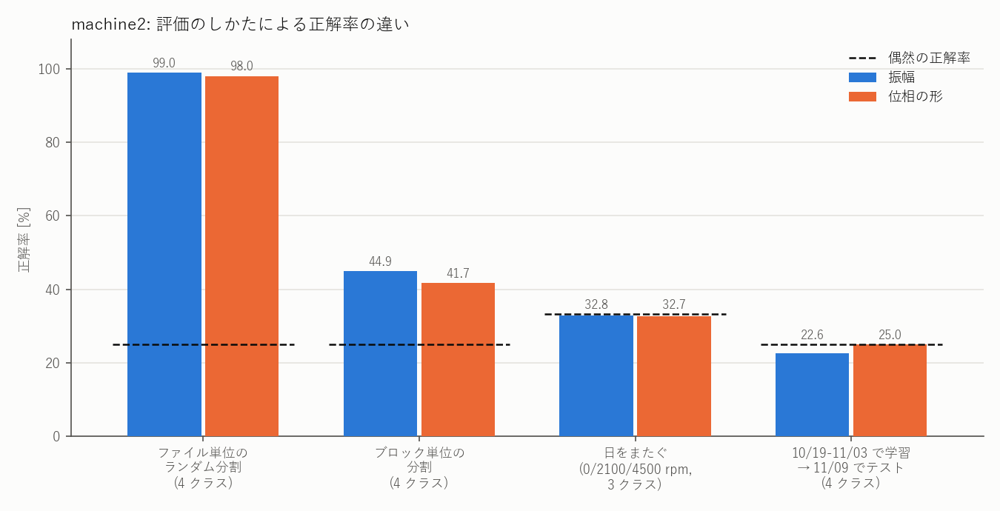
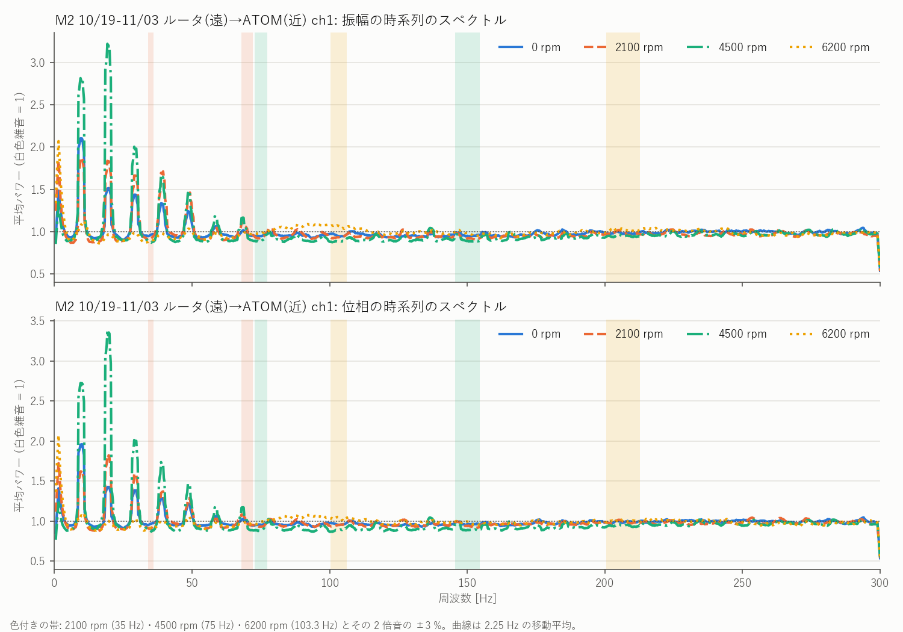

# 別の部屋・別の機械（machine2）のデータの解析

作成日: 2026-11-23
関連資料: [10月までのデータを加えた追加解析レポート.md](10月までのデータを加えた追加解析レポート.md)、[回転周波数のスペクトル解析レポート.md](回転周波数のスペクトル解析レポート.md)、[位相を使った解析レポート.md](位相を使った解析レポート.md)

---

## 1. 対象データ

| 項目 | 内容 |
|---|---|
| フォルダ | `1019-1103_machine2_rpm_router-f_atoms3-n_ch1_2228`（以下 **M2-A**）、`1109_machine2_rpm_router-f_atoms3-n_ch1_2214`（以下 **M2-B**） |
| 部屋 | **2228**（M2-A・M2-B とも）。これまでのデータの部屋（2214）とは別で、2214 よりかなり広い（大きさは未測定）。M2-B のフォルダ名の末尾は `_2214` だが、測定環境の記録と研究者の確認により 2228 が正しい |
| 機械 | ドリル（HOZAN K-21） |
| 回転数 | 0 / 2100 / 4500 / 6200 rpm（機械の都合）。**タコメータで測定しており、表記どおりの回転数**（研究者の確認）。M2-A のフォルダ名は「2000rpm」だが、研究者によると 2100 rpm（5.1 節で 2000 rpm の帯域も確認した） |
| 送受信 | ルータ（遠）→ ATOM S3（近）、ch1 |
| 測定のしかた | モータが熱で焼き切れるのを防ぐため、**40 ファイルを 1 ブロック**として、回転数を入れ替えながら複数回に分けて測定 |
| ファイル | 1 ファイル 500 パケット（約 8.4 s）、ファイル間の間隔は約 2 s。1 ブロックは約 7 分 |

各クラスのブロックの測定日:

| クラス | M2-A（各 10 ブロック、400 ファイル） | M2-B（各 2 ブロック、80 ファイル） |
|---|---|---|
| 0 rpm | 10/19（b1〜3）、10/22（b4）、10/26（b5〜7）、10/27（b8）、11/01（b9〜10） | 11/09 |
| 2100 rpm | 10/19（b1〜3）、10/22（b4）、10/26（b5〜6）、10/27（b7〜8）、11/01（b9〜10） | 11/09 |
| 4500 rpm | 10/19（b1〜2）、10/22（b3〜4）、10/26（b5〜6）、10/27（b7〜8）、11/01（b9〜10） | 11/09 |
| 6200 rpm | **11/02（b1〜4）、11/03（b5〜10）** | 11/09 |

- M2-A では、**0・2100・4500 rpm を同じ 5 日（10/19、10/22、10/26、10/27、11/01）に測っている**。これまでのデータ（1 クラス = 1 回の連続測定）と違い、「別の日に測った同じ回転数」と「同じ日に測った別の回転数」の両方がある。これによって、回転数の違いとセッション（ブロック・日）の違いを切り分けられる。
- **6200 rpm だけは、他のクラスを測っていない 11/02・11/03 に測っている。** M2-A の中では、6200 rpm と測定日の違いを区別できない。
- M2-B は、4 クラスとも同じ日（11/09）に測っている。

> **部屋について:** M2-B のフォルダ名の末尾は `_2214` だが、測定環境の記録（`測定環境.xlsx - シート1.pdf`）と研究者の確認（2026-11-23）により、11/09 も M2-A と同じ **2228** で測定している。したがって、M2-A で学習して M2-B でテストする評価（E6）は、**同じ部屋・同じ機械で、日だけが違う**テストである。

## 2. 結論

1. **ファイル単位のランダム分割では、これまでと同じく正解率はほぼ 100 % になる**（4 クラスで振幅 99.0 %、位相の形 98.0 %）。
2. **ところが、学習に使っていないブロックや日でテストすると、回転数は当たらなかった。**
   - 0・2100・4500 rpm を、他の 4 日で学習して残りの 1 日でテストすると、正解率は **32.8 %（振幅）・32.7 %（位相の形）** で、偶然（33.3 %）と同じだった。
   - M2-A で学習して M2-B（11/09）でテストすると、4 クラスで 22.6〜27.0 %（偶然は 25 %）だった。
3. **同じ回転数・同じ日の別ブロックどうしは、94〜100 % で見分けられた。** 約 7 分の測定 1 回分の違いがあるだけで、CSI の時間平均の形はほぼ確実に区別できるほど変わる。
4. **同じ日の他のブロックで学習し、残した 1 ブロックをテストすると、正解率は偶然より大きく低かった**（0/2100/4500 rpm の 3 クラスで、日ごとに 2.1〜40.6 %。偶然は 33.3 %）。テストしたブロックは、同じ回転数の別ブロックより、同じ日の別の回転数のブロックに似ていると判定される。CSI は回転数ではなく、セッション（測定の時間帯やルータの状態）で決まっていることを示している（4.5 節）。
5. ブロック単位で分けた評価（4 クラス、44.9 %）で 6200 rpm だけが当たった（再現率 87 %）。これは、6200 rpm だけが別の日（11/02・11/03）に測られていて、ほぼ全ブロックが W 形式であることによる。フレーム形式の比率だけでも 6200 rpm の再現率は 74 % になり、M2-B の 6200 rpm には当てはまらなかった。
6. **スペクトルにも、回転周波数（35 / 75 / 103.3 Hz）の成分は見つからなかった。** 回転数はタコメータで確認されているので、実際の回転数が期待帯域から外れていた可能性はない。注入テストでは、平均振幅の 2〜5 % の成分なら検出できる感度があった。
7. このデータには、**ルータのビーコン間隔（102.4 ms = 9.77 Hz）の倍音**がはっきり出ていた。0 rpm にも出るので回転とは関係ないが、強さがクラス（測定日）によって違い、セッションの違いの一因になっている。

**まとめ:** 回転数を何日にも分けて測った今回のデータで、これまでのレポートで「可能性が高い」としていたことが、より直接的に確かめられた。**この測定系の CSI から回転数を識別できているように見えたのは、測定セッションの違いを見分けていたためである。** 今のところ、セッションの違いとは別に回転数の情報が CSI に含まれているという証拠は、振幅・位相・スペクトルのどれからも得られていない。

## 3. データの概要

### 3.1 フレーム形式

これまでのルータ条件と同じく、パケットごとにフレーム形式（S・D・W・WD）が混在していた（形式の定義は [フレーム形式検証レポート.md](フレーム形式検証レポート.md) 3 節）。**形式はブロックごとに大きく変わり、同じ日・同じ回転数でもブロックによって違った。**

| 例 | 形式の比率（S / D / W / WD, %） |
|---|---|
| 0 rpm 10/19 b1 | 0 / 0 / 61 / 39 |
| 0 rpm 10/19 b3 | 38 / 62 / 0 / 0 |
| 0 rpm 10/26 b7 | 99 / 1 / 0 / 0 |
| 2100 rpm 11/09 b1 | 0 / 0 / 2 / 98 |
| 2100 rpm 11/09 b2 | 0 / 0 / 100 / 0 |
| 6200 rpm（全 10 ブロック） | W・WD のみ（S・D は 0 %） |

ルータがブロック（接続）ごとに送り方を切り替えていると考えられる。P_dir もブロックごとに 18〜94 % と大きくばらついた。

### 3.2 特徴量のそろえ方

各ファイルで最も多い形式のパケットだけを使い、サブキャリアを k = −28〜28 の 57 本にそろえた（[位相を使った解析レポート.md](位相を使った解析レポート.md) 3.1 節と同じ並び）。S 形式と W 形式が同じ時間帯に混ざっているブロック（2100 rpm 10/26 b5）で、両形式の振幅の形を比べると相関は 0.79 で、並びのそろえ方はおおむね正しい。ただし、ブロックが違うと形式ごとの振幅の形はかなり違い、形式そのものが特徴量に影響している。

| 特徴量 | 内容 |
|---|---|
| amp | 振幅の時間平均（57） |
| norm | amp をファイル内の平均で割ったもの（57） |
| pmean | 補正後の位相の時間平均（57、位相の形） |
| amp+pmean | amp と pmean を並べたもの（114） |
| share | 4 形式の比率だけ（4）。フレーム形式の交絡の目安 |

## 4. 識別の結果



### 4.1 評価のしかたごとの正解率（%）

| 評価 | 偶然 | amp | norm | pmean | amp+pmean | share |
|---|---|---|---|---|---|---|
| E1 ファイル単位のランダム分割（4 クラス） | 25 | 99.0 | 99.2 | 98.0 | 99.1 | 43.9 |
| E2 ブロック単位の分割（4 クラス） | 25 | 44.9 | 43.8 | 41.7 | 44.9 | 32.5 |
| E3 日をまたぐ（0/2100/4500 rpm, 3 クラス） | 33.3 | **32.8** | 27.7 | **32.7** | 35.3 | 32.2 |
| （参考）E3 と同じデータのランダム分割 | 33.3 | 98.3 | 98.1 | 96.2 | 98.1 | 45.3 |
| E6 M2-A で学習 → M2-B でテスト（4 クラス） | 25 | 22.6 | 22.3 | 25.0 | 27.0 | 24.8 |
| E6 同（0/2100/4500 rpm, 3 クラス） | 33.3 | 38.8 | 20.0 | 33.3 | 40.3 | 33.9 |

- **E2 ブロック単位の分割:** テストするブロックのファイルを学習に一切含めない（GroupKFold 10 分割）。
- **E3 日をまたぐ:** 0・2100・4500 rpm を同じ 5 日に測っているので、4 日で学習して残りの 1 日でテストする（leave-one-day-out）。**回転数とセッションの違いを切り分けた、最も直接的なテスト**である。
- **E6:** M2-A と M2-B は同じ部屋（2228）・同じ機械なので、日だけが違う条件でのテストになる。

### 4.2 日をまたいだテスト（E3）の内訳

| テストした日 | amp | norm | pmean | amp+pmean |
|---|---|---|---|---|
| 10/19 | 23.4 | 38.3 | 31.4 | 23.1 |
| 10/22 | 33.5 | 34.6 | 46.2 | 50.8 |
| 10/26 | 34.8 | 25.7 | 31.4 | 39.3 |
| 10/27 | 33.7 | 21.3 | 20.5 | 26.0 |
| 11/01 | 38.6 | 18.3 | 33.8 | 37.1 |
| **平均** | **32.8** | **27.7** | **32.7** | **35.3** |

amp で、5 日分を合わせた混同行列（3 シード分の合計）:

| 正解 \ 予測 | 0 rpm | 2100 rpm | 4500 rpm |
|---|---|---|---|
| 0 rpm | 159 | 357 | **684** |
| 2100 rpm | 204 | **506** | 490 |
| 4500 rpm | 208 | 499 | **493** |

0 rpm の 57 % が 4500 rpm と予測されるなど、予測は回転数とほとんど関係がない。どの特徴量でも、一貫して偶然を上回る日はなかった。

### 4.3 セッションの違いの大きさ（E5 対照）

同じ回転数・同じ日に複数のブロックがある組（14 組）で、ブロックを擬似クラスにしてランダム分割で識別した。回転数は同じなので、当たるとすればセッションの違いだけによる。

| 特徴量 | 正解率の範囲 | 平均 |
|---|---|---|
| amp | 94.4〜100 | 96.9 |
| norm | 93.8〜100 | 97.3 |
| pmean | 93.8〜100 | 97.5 |
| share | 37.5〜100 | 74.0 |

（偶然は 2 ブロックの組で 50 %、3 ブロックで 33 %、4 ブロックで 25 %、6 ブロックで 17 %）

**同じ回転数・同じ日でも、ブロックが違えば 94〜100 % で見分けられる。** これまでのデータで「1 クラス = 1 回の連続測定」だったことを考えると、ランダム分割でのほぼ 100 % の正解率は、このセッションの違いで十分に説明できる。

### 4.4 6200 rpm がブロック単位の分割で当たった理由

E2（ブロック単位の分割）の再現率は、0 rpm 18 %、2100 rpm 26 %、4500 rpm 49 %、**6200 rpm 87 %**（amp）だった。6200 rpm だけ高いのは、次の理由による。

- 6200 rpm だけが、他のクラスを測っていない 11/02・11/03 に測られている。
- 6200 rpm の全ブロックが W・WD 形式で、S・D 形式を含まない。**形式の比率（share）だけでも、6200 rpm の再現率は 74 %** になった。
- M2-B（11/09、M2-A と同じ部屋・同じ機械で、4 クラスを同じ日に測定）でテストすると、4 クラス全体で 22.6〜27.0 % だった。6200 rpm を見分けられるのは、6200 rpm を測った日に固有の性質を拾っているからである。

### 4.5 同じ日の中での leave-one-block-out

回転数を入れ替えながら測っているので、同じ日の中に、別の回転数のブロックが交互に並んでいる。そこで、**同じ日の他のブロック（別の回転数のブロックも含む）で学習し、残した 1 ブロックをテストした。** 学習とテストが同じ日（同じ設置状態）なので、日ごとの設置のずれの影響を受けない、最も有利な条件でのセッションをまたいだ評価である。テストできるのは、その日に同じ回転数のブロックが 2 つ以上あるブロックに限った（学習側にもその回転数のブロックが残るように）。

| 日 | クラス | テストしたブロック | 偶然 | amp | norm | pmean | amp+pmean | share |
|---|---|---|---|---|---|---|---|---|
| 10/19 | 0/2100/4500 | 8 | 33.3 | 3.3 | 7.9 | 0.7 | 9.6 | 23.1 |
| 10/22 | 0/2100/4500 | 2（4500 rpm のみ） | 33.3 | 2.1 | 11.7 | 0.0 | 0.0 | 46.2 |
| 10/26 | 0/2100/4500 | 7 | 33.3 | 14.5 | 34.8 | 28.6 | 6.4 | 7.4 |
| 10/27 | 0/2100/4500 | 4（2100・4500 rpm） | 33.3 | 40.6 | 25.4 | 21.2 | 41.2 | 25.6 |
| 11/01 | 0/2100/4500 | 6 | 33.3 | 20.3 | 10.7 | 13.2 | 19.6 | 17.6 |
| 11/09 | 4 クラス | 8 | 25.0 | 18.8 | 15.8 | 11.7 | 16.6 | 5.5 |

（%。テストしたブロックのファイル全体での正解率）

- **ほとんどの日で、正解率は偶然より大きく低い。** ブロックごとに見ると、amp では 35 ブロック中 27 ブロックが 0〜12 % だった（`results/machine2/within_day.json`）。
- 偶然より低いということは、テストしたブロックが、**同じ回転数の別ブロックよりも、同じ日の別の回転数のブロックのほうに系統的に似ている**ということである。回転数の情報があれば、少なくとも偶然以上には当たるはずなので、CSI の時間平均の形は回転数ではなく、セッション（測定の時間帯、ルータの状態）で決まっていると考えられる。
- 偶然を上回ったのは、10/26 の 0 rpm b7（100 %。この日の他のブロックと違い、ほぼ全パケットが S 形式）、10/27 の 4500 rpm（2 ブロックとも 78〜85 %）、11/01 の 4500 rpm（54〜68 %）、11/09 の 4500 rpm（37〜38 %）と 6200 rpm b1（75 %）の 8 ブロックだけだった。同じ日の他の回転数のブロックはほぼ 0 % で、特定の回転数だけが日をまたいで一貫して当たる、という傾向はない。

## 5. スペクトルの結果

### 5.1 回転周波数の帯域

[回転周波数のスペクトル解析レポート.md](回転周波数のスペクトル解析レポート.md) と同じ方法（不等間隔 DFT、回転周波数と 2 倍音の ±3 %、帯域を 5〜45 Hz ずらした帰無分布）で、振幅と位相の時系列を調べた。ルータ送信なのでサンプリング格子はなく、回転周波数はそのまま現れるはずである。

| 回転数 | 回転周波数 | 2 倍音 |
|---|---|---|
| 2100 rpm | 35.0 Hz | 70.0 Hz |
| 4500 rpm | 75.0 Hz | 150.0 Hz |
| 6200 rpm | 103.3 Hz | 206.7 Hz |

**同じ日の 0 rpm との比較（AUC、括弧内は帰無分布のパーセンタイル）:**

| 日 | 2100 rpm 振幅 | 2100 rpm 位相 | 4500 rpm 振幅 | 4500 rpm 位相 |
|---|---|---|---|---|
| 10/19 | 0.49（10） | 0.51（12） | 0.45（55） | 0.48（55） |
| 10/22 | 0.77（100） | 0.71（92） | 0.58（80） | 0.58（88） |
| 10/26 | 0.62（98） | 0.53（85） | 0.56（100） | 0.66（98） |
| 10/27 | 0.43（28） | 0.41（35） | 0.35（32） | 0.40（75） |
| 11/01 | 0.44（15） | 0.49（38） | 0.39（32） | 0.44（12） |
| 11/09 | 0.41（12） | 0.40（8） | 0.54（60） | 0.63（98） |

AUC は日によって 0.35〜0.77 とばらつき、0.5 より上の日と下の日が同じくらいある。**一貫して回転周波数の成分が強い、という結果にはならなかった。** フォルダ名どおり 2000 rpm（33.3 Hz）の帯域で調べても、AUC は 0.43〜0.64 で、結果は変わらなかった（`results/machine2/within_day.json`）。

**6200 rpm:** 0 rpm との比較で、AUC は M2-A で振幅 0.57・位相 0.62、M2-B で振幅 0.61・位相 0.71 と、やや高かった。しかし詳しく見ると、回転による成分とは考えにくい。

- ブロックごとのスペクトルに、103.3 Hz の細い線はない。101〜106 Hz の値は 1.07〜1.56（白色雑音 = 1）で、ピークとその周り（±5〜10 Hz）の比は 1.00〜1.16 しかない。ピークの位置もブロックによって 91〜112 Hz の間で動く。
- **W・WD 形式のブロックは、回転数によらず 101〜106 Hz の値が高い**（0 rpm 1.16、2100 rpm 1.21、4500 rpm 1.17。S・D 形式のブロックは 0.94〜1.07）。6200 rpm は全ブロックが W・WD 形式である。
- W・WD 形式のブロックだけで比べると、6200 rpm（1.26）と他の回転数の差は有意ではなかった（AUC 0.67、p = 0.12）。
- これまでのルータ条件でも、0 rpm を含めて 103〜112 Hz 付近に幅の広い成分があった（[回転周波数のスペクトル解析レポート.md](回転周波数のスペクトル解析レポート.md) 5.3 節）。

### 5.2 ビーコン間隔の倍音



振幅・位相のどちらのスペクトルにも、**9.75、19.5、29.25、39.0 Hz … のくし状のピーク**がある。これはルータのビーコン間隔（102.4 ms、9.766 Hz）の倍音と一致する。

| クラス | 9.8 Hz | 19.5 Hz | 29.3 Hz | 39.1 Hz | 48.8 Hz |
|---|---|---|---|---|---|
| 0 rpm | 8.34 | 4.15 | 3.06 | 2.12 | 1.75 |
| 2100 rpm | 6.60 | 5.63 | 4.14 | 2.93 | 1.77 |
| 4500 rpm | 13.42 | 14.35 | 5.90 | 3.20 | 2.37 |
| 6200 rpm | 1.24 | 1.01 | 1.04 | 1.02 | 1.06 |

（振幅のクラス平均スペクトルの、各倍音 ±0.6 Hz の最大値。白色雑音 = 1）

- 0 rpm にも強く出ているので、回転とは関係ない。ビーコンと ping の応答で CSI が少し違い、ビーコンの周期で振幅・位相が変わっているものと考えられる。
- 強さはクラス（測定日）によって大きく違い、6200 rpm（11/02・11/03）ではほとんど出ていない。ルータの状態が日やセッションによって変わることを示しており、これもセッションの違いの一因である。
- 元の部屋のデータでは、ビーコンの倍音の位置のパワーは高くなかった（[回転周波数のスペクトル解析レポート.md](回転周波数のスペクトル解析レポート.md) 5.3 節）。部屋やルータの状態で出方が変わると考えられる。

### 5.3 感度（注入テスト）

M2-A の 0 rpm（各ブロックから 20 ファイル）に、回転周波数で周期的に強さが変わる反射成分を加えた（[位相を使った解析レポート.md](位相を使った解析レポート.md) 4.4 節と同じモデル）。

| 回転数 | ρ = 1 %（振幅 / 位相） | ρ = 2 % | ρ = 5 % |
|---|---|---|---|
| 2100 rpm（35 Hz） | 0.59 / 0.68 | 0.92 / 0.90 | 0.99 / 0.98 |
| 4500 rpm（75 Hz） | 0.59 / 0.70 | 0.92 / 0.88 | 0.98 / 0.97 |
| 6200 rpm（103.3 Hz） | 0.45 / 0.45 | 0.58 / 0.59 | 0.92 / 0.85 |

（AUC。ρ は平均振幅に対する反射成分の大きさ）

2100・4500 rpm では平均振幅の 2 % の成分で AUC 0.9 前後、6200 rpm では 5 % で 0.85〜0.92 になる。6200 rpm の感度が低いのは、103 Hz 付近にもともと幅の広い成分（5.1 節）があるためである。それでも、数 % の大きさの回転成分があれば検出できたはずである。

## 6. 解釈

### 6.1 これまでの結論との関係

これまでのデータでは、1 つの回転数を 1 回の連続測定でまとめて取っていたため、「回転数の違い」と「セッションの違い」を区別できなかった（[10月までのデータを加えた追加解析レポート.md](10月までのデータを加えた追加解析レポート.md) 7 節）。そのため「日内の高精度の大部分はセッションの違いによる可能性が高い」としていた。

今回の machine2 データは、回転数を何日にも分けて測っているので、この点を直接確かめられた。

| 確かめたこと | 結果 |
|---|---|
| 同じ回転数でも、セッションが違えば見分けられるか | **見分けられる**（同じ日の別ブロックでも 94〜100 %） |
| 別の日に測った同じ回転数を、正しく当てられるか | **当てられない**（3 クラスで 32.8 %、偶然 33.3 %） |
| 同じ日の別のブロックで学習すれば、残したブロックの回転数を当てられるか | **当てられない。偶然より低い**（0.0〜40.6 %） |
| 回転周波数の成分がスペクトルにあるか | **ない**（数 % の成分なら検出できる感度で） |

部屋と機械が違っても、元のデータと同じ結果になった。**この測定系では、CSI の時間平均の形はセッションごとに大きく変わり、その変化は回転数による変化よりずっと大きい**と結論できる。

### 6.2 セッションの違いの原因の候補

このデータから分かった候補は次のとおり。

1. **ルータのフレーム形式の切り替わり**（ブロックごとに S・D と W・WD が入れ替わる。3.1 節）
2. **ビーコンの影響の強さの変化**（5.2 節）
3. 部屋の中の人や物の位置、温度などの環境の変化（今回のデータでは確かめられない）

1 と 2 はルータを送信機に使うことによるもので、ATOM S3 / ESP32-S3 を送信機にすれば取り除ける。ただし、元の部屋の ATOM・ESP 送信の条件でも、時間区間を見分ける対照テストは 63〜67 % だった（[10月までのデータを加えた追加解析レポート.md](10月までのデータを加えた追加解析レポート.md) 7.2 節）ので、3 の環境の変化も無視できない。

### 6.3 この解析の限界

1. **6200 rpm は M2-A の中で測定日と完全に重なっている。** M2-B で 4 クラスを同じ日に測っているが、2 ブロックずつしかない。
2. **ブロックの測定順・時刻が分からない。** 同じ日の中で、どのクラスをどの順番で測ったかの記録がない。
3. **ブロックごとのタコメータの値は記録されていない。** 回転数はタコメータで測っていて表記どおりと確認されているが、ブロックごとの実測値が残っていれば、わずかなずれまで確かめられる。

## 7. 提案

1. **タコメータの値をブロックごとに記録として残す。** 回転数はタコメータで測っているので、その値をファイルやブロックと対応づけて残せば、わずかな回転数のずれまで照らし合わせられる。
2. **送信機を ATOM S3 / ESP32-S3 にする。** ルータのフレーム形式の切り替わりやビーコンの影響がなくなり、セッションの違いの原因を減らせる。その場合、送信間隔を回転周波数と整数比にならない値にするか、ばらつかせる（[回転周波数のスペクトル解析レポート.md](回転周波数のスペクトル解析レポート.md) 6 節）。
3. **今回のブロック測定（回転数を入れ替えながら測る）のやり方は続ける。** さらに、各ブロックの開始時刻と順番を記録する。6200 rpm も他の回転数と同じ日に測る。
4. **評価は、日またはブロック単位で分ける**（E2・E3 の方法）。ファイル単位のランダム分割の正解率は、回転数の識別性能の根拠にならない。
5. 回転部を送受信の経路（第 1 フレネルゾーン）の中に置き、回転による変化を大きくする。

## 8. 再現手順

`c:\卒業研究\reproduce\` で次を順に実行する。

```
python machine2_common.py      # キャッシュ作成 → cache_machine2/*.npz
python machine2_features.py    # 特徴量・スペクトル → results/machine2/features_*.npz
python machine2_analysis.py    # 識別の検証 (E1〜E6) → results/machine2/analysis.json
python machine2_spectrum.py    # スペクトル・注入テスト → results/machine2/spectrum.json
python machine2_figures.py     # 図 → report/figures/machine2_*.png
python machine2_within_day.py  # 日内の leave-one-block-out、2000 rpm 帯域の確認 → results/machine2/within_day.json
```

| ファイル | 役割 |
|---|---|
| `machine2_common.py` | machine2 データの読み込み（ブロック番号・測定日をファイル名から取得） |
| `machine2_features.py` | 形式をそろえた振幅・位相の特徴量と、振幅・位相のスペクトル |
| `machine2_analysis.py` | ランダム分割・ブロック単位・日をまたぐ評価と、セッションの対照テスト |
| `machine2_spectrum.py` | 回転周波数の帯域の AUC と注入テスト |
| `machine2_figures.py` | 図の作成 |
| `machine2_within_day.py` | 同じ日の中での leave-one-block-out（4.5 節）と、2000 rpm 帯域のスペクトルの確認 |
