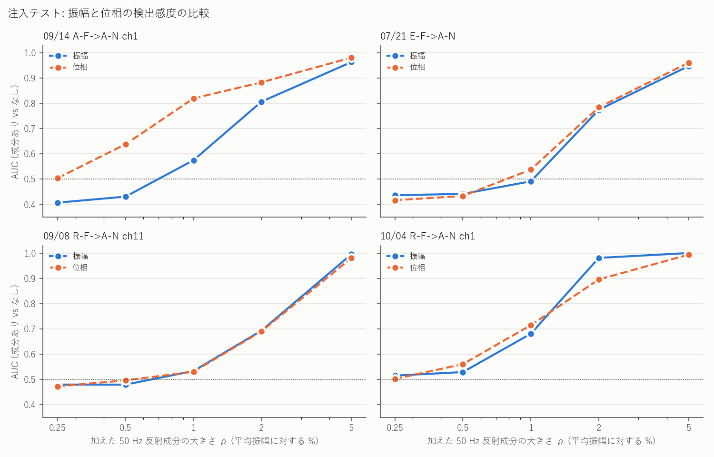

# CSI の位相を使った解析

作成日: 2026-11-22
関連資料: [10月までのデータを加えた追加解析レポート.md](10月までのデータを加えた追加解析レポート.md)、[回転周波数のスペクトル解析レポート.md](回転周波数のスペクトル解析レポート.md)（どちらも振幅だけを使っていた）

---

## 1. 目的

これまでの解析はすべて CSI の振幅だけを使っていた。位相は、反射物のわずかな動き（経路長の変化）に敏感で、回転のような動きを捉えやすい可能性がある。そこで、位相を使って次の 3 点を調べた。対象は 06/18〜10/28 の 31 条件。

1. 位相の形で、回転数を（日内・日をまたいで）識別できるか。
2. 振幅で見られた「セッションの違いでも当たってしまう」問題は、位相でも同じか。
3. 位相の時系列に、回転周波数の成分があるか。

## 2. 結論

1. **位相の形でも、日内では高い正解率になる**（ランダム分割で平均 91.7 %）。ただし振幅と同じく、時間方向の分割では 75.9 % に下がり、同じ回転数の時間区間どうしも 63.7 % で見分けられる。**位相の形もセッションごとに違い、回転数とセッションの違いを区別できない**という点は振幅と同じだった。
2. **日をまたぐと、位相でもほぼ偶然の水準だった**（leave-one-day-out の平均 29.1 %、振幅と位相を組み合わせても 29.8 %）。振幅だけ（24.9 %）よりわずかに高いが、一貫して当たる日はない。
3. **位相の時系列にも、回転周波数の成分は検出されなかった**（82 通りの AUC の中央値 0.52。帯域をずらした場所と比べて目立つものは 0 通り）。
4. **位相の感度は振幅と同程度か、少し高い。** 周期的に変わる反射成分を人工的に加えると、ATOM 送信（09/14）では、位相は平均振幅の 1 % の成分で AUC 0.82（振幅は 0.58）だった。他の 3 条件では振幅とほぼ同じで、どちらも 2〜5 % で検出できた。それでも実データに成分が見つからないので、**回転による周期的な反射成分は、少なくとも直接波の 2〜5 % より小さい**。

**まとめ:** 位相を使っても、振幅での結論は変わらなかった。今のデータからは、セッションの違いとは別に回転数の情報があることを示せない。

## 3. 位相の補正

### 3.1 補正の方法（`phase_features.py`）

ESP32 の CSI の位相には、パケットごとに次のずれが乗る。

| ずれ | 原因 | 位相への現れ方 |
|---|---|---|
| 共通のずれ | 送受信の周波数のずれ（CFO）、PLL の初期位相 | 全サブキャリアで同じ量 |
| 傾き | 受信タイミングのずれ（STO）、サンプリング周波数のずれ（SFO） | サブキャリア番号に比例 |

どちらもパケットごとにランダムに変わるので、そのままでは使えない。そこで、パケットごとに次のように除いた。

1. **傾き:** 隣り合うサブキャリアの積 Σ H[k+1]·conj(H[k]) の偏角。位相のアンラップ（2π の飛びをつなぐ処理）がいらないので、振幅が深く落ち込むサブキャリアがあっても安定する。最初に試したアンラップと直線当てはめでは、ルータ条件で当てはめの残差が 0.8〜1.0 rad と大きく、うまくいかなかった。
2. **共通のずれ:** 傾きを除いた後の Σ H[k] の偏角。

補正後に残るのは、サブキャリアによって非線形に変わる位相（マルチパスの形）である。

サブキャリア番号は k = −28〜28 の 57 本にそろえた。S・D 形式は列 2〜58 を k = 列 − 30、W・WD 形式は列 1〜28 を k = 1〜28、列 36〜63 を k = −28〜−1 とした（[CSI形式とファームウェア設定の解説.md](CSI形式とファームウェア設定の解説.md) 2.2 節の並び）。ルータ条件は、振幅のスペクトル解析と同じく、そのファイルで最も多い形式のパケットだけを使った。

### 3.2 補正後の位相の安定性

補正後の位相が時間とともにどれくらい揺らぐかを、ファイル内の標準偏差で見た（条件ごとの中央値）。

| 送信機 | 揺らぎ（rad） |
|---|---|
| ATOM S3 | 0.04〜0.21（多くは 0.04〜0.07） |
| ESP32-S3 | 0.05〜0.10 |
| ルータ | 0.03〜0.37（06/18・06/22・08/04 が 0.27〜0.37 と大きい） |

ATOM・ESP では 0.05 rad（約 3°）程度と安定していて、位相を特徴量として使える。ルータ条件で揺らぎが大きい日の理由は分からない。D・WD 形式の比率とは対応していない（06/18・06/22 は D・WD 形式が 9 割以上だが、同じく 9 割以上の 07/09 は 0.07 rad と小さく、2 割程度の 08/04 は 0.27 rad と大きい）。

### 3.3 特徴量

| 名前 | 内容 |
|---|---|
| **pmean** | 補正後の位相の時間平均（57 次元）。位相の形 |
| **pstd** | 位相の時間方向の揺らぎ（57 次元） |
| amp | 振幅の時間平均（列 2〜58、57 次元）。比較用 |
| amp+pmean | amp と pmean を並べたもの（114 次元） |

## 4. 結果

### 4.1 日内の識別（31 条件の平均, %）

| 特徴量 | ランダム分割 | 時間方向の分割 | 時間ブロックの対照 |
|---|---|---|---|
| **pmean（位相の形）** | **91.7** | **75.9** | **63.7** |
| pstd（位相の揺らぎ） | 74.9 | 62.0 | 45.9 |
| amp（振幅） | 95.2 | 76.5 | 70.8 |
| amp+pmean | 96.1 | 77.8 | 72.7 |

（偶然なら 25 %。時間方向の分割と時間ブロックの対照の定義は [10月までのデータを加えた追加解析レポート.md](10月までのデータを加えた追加解析レポート.md) 7.1 節。時間ブロックの対照は、同じ回転数の 1 セッションを時間順に 4 等分した擬似クラスの正解率で、当たるとすれば時間変化だけによる）

送信機ごと（pmean）:

| 送信機 | ランダム分割 | 時間方向の分割 | 時間ブロックの対照 |
|---|---|---|---|
| ルータ（14 条件） | 93.5 | 71.2 | 72.3 |
| ATOM S3（9 条件） | 94.2 | 83.9 | 58.3 |
| ESP32-S3（8 条件） | 85.7 | 75.0 | 54.8 |

- 位相の形（pmean）は、振幅とほぼ同じ傾向を示した。ランダム分割では高く、時間的に離れると下がり、回転数が同じでも時間区間を見分けられる。
- 時間ブロックの対照は、振幅（70.8 %）より位相（63.7 %）のほうが少し低い。位相の形のほうが、時間変化の影響をやや受けにくいということである。それでも偶然（25 %）よりずっと高い。
- 時間方向の分割で 90 % 以上を保ったのは、pmean では 06/30 A-N→A-N、07/10、07/27、09/08、09/10、09/14、09/24、10/28 の 8 条件だった。このうち 5 条件（06/30 A-N→A-N、07/10、09/08、09/14、10/28）は、振幅でも 90 % 以上を保った条件である。
- 振幅と位相を組み合わせても、改善はわずか（ランダム分割 +0.9 pt、時間方向の分割 +1.3 pt）だった。

### 4.2 日をまたいだ識別（leave-one-day-out, %）

| テストした日 | pmean | pstd | amp | amp+pmean |
|---|---|---|---|---|
| 06/18 R-N→A-N | 29.8 | 31.2 | 8.8 | 14.3 |
| 07/09 R-N→A-N | 18.9 | 31.7 | 25.3 | 26.4 |
| 08/03 R-N→A-N | 24.3 | 25.0 | 22.1 | 22.1 |
| 06/22 R-F→A-N | **46.1** | 26.5 | 13.8 | 32.3 |
| 07/10 R-F→A-N | 27.9 | 12.3 | 25.4 | 23.3 |
| 08/04 R-F→A-N | 29.4 | 23.4 | 17.5 | 27.9 |
| 09/07 R-F→A-N ch11 | 30.5 | 20.6 | 22.1 | 26.4 |
| 09/08 R-F→A-N ch11 | **44.4** | 28.6 | 26.5 | **50.5** |
| 09/10 R-F→A-N ch11 | 15.1 | 35.2 | 27.4 | 32.2 |
| 10/01 R-F→A-N ch11 | 30.0 | 27.7 | 32.0 | 25.4 |
| 10/04 R-F→A-N ch1 | 27.8 | 25.4 | 23.1 | 24.9 |
| 06/29 R-F→A-F | 36.1 | 27.3 | 22.8 | 27.1 |
| 07/11 R-F→A-F | 30.3 | 29.2 | 30.8 | 32.1 |
| 08/06 R-F→A-F | 25.0 | 25.0 | 25.0 | 30.8 |
| 06/30 A-F→A-N | 25.0 | 24.1 | 29.6 | **50.0** |
| 09/14 A-F→A-N ch1 | 22.6 | 28.0 | 25.1 | 25.0 |
| 09/17 A-F→A-N ch1 | 25.0 | 23.9 | 39.0 | 25.0 |
| 10/28 A-F→A-N ch11 | 34.8 | 27.5 | 31.9 | 40.6 |
| **平均** | **29.1** | **26.3** | **24.9** | **29.8** |

- 位相を使うと平均はわずかに上がる（振幅 24.9 % → 位相 29.1 %）。しかし、40 % を超えたのは 18 通り中 4 通り（pmean か amp+pmean）だけで、特徴量によって当たる日が入れ替わる。**日をまたいで一貫して使える情報とは言えない。**

### 4.3 位相の時系列のスペクトル

[回転周波数のスペクトル解析レポート.md](回転周波数のスペクトル解析レポート.md) と同じ方法（不等間隔 DFT、回転周波数とその 2 倍音の ±3 %、折り返しを含む期待帯域、帯域をずらした帰無分布）を、位相のずれ angle(H_s · conj(平均 H_s)) の時系列に当てはめた。

| 指標 | 位相 | （参考）振幅 |
|---|---|---|
| AUC の中央値（四分位範囲） | 0.52（0.47〜0.58） | 0.51（0.46〜0.57） |
| AUC ≥ 0.7 | 3 通り | 5 通り |
| AUC ≥ 0.7 かつ帰無分布の 95 パーセンタイル以上 | **0 通り** | 1 通り |
| 帯域パワー 3 次元での識別（日内ランダム分割） | 32.9 % | 33.9 % |

位相の時系列にも、回転周波数の成分は見つからなかった。条件ごとの値は `results/phase_eval.json` の `spectral` を参照。

### 4.4 感度の比較（注入テスト）

0 rpm のファイルに、回転によって周期的に強さが変わる反射経路の成分を加えた。

  H'(k, t) = H_s(k, t) + ρ · 平均|H| · exp(i(2πkτ/64 + ψ)) · sin(2πft + φ)

τ（経路の遅延）・ψ・φ はファイルごとにランダムにした。この成分は振幅と位相の両方を変えるので、同じ条件で両者の感度を比べられる。



| 条件 | f | ρ = 1 %（振幅 / 位相） | ρ = 2 % | ρ = 5 % |
|---|---|---|---|---|
| 09/14 A-F→A-N ch1 | 50 Hz | 0.58 / **0.82** | 0.81 / 0.88 | 0.96 / 0.98 |
| 09/14 A-F→A-N ch1 | 150 Hz | 0.50 / **0.85** | 0.83 / 0.93 | 1.00 / 1.00 |
| 07/21 E-F→A-N | 50 Hz | 0.49 / 0.54 | 0.77 / 0.78 | 0.95 / 0.96 |
| 07/21 E-F→A-N | 150 Hz | 0.53 / 0.61 | 0.70 / 0.81 | 0.97 / 0.98 |
| 09/08 R-F→A-N ch11 | 50 Hz | 0.53 / 0.53 | 0.69 / 0.69 | 0.99 / 0.98 |
| 09/08 R-F→A-N ch11 | 150 Hz | 0.54 / 0.52 | 0.70 / 0.64 | 1.00 / 0.98 |
| 10/04 R-F→A-N ch1 | 50 Hz | 0.68 / 0.71 | 0.98 / 0.90 | 1.00 / 0.99 |
| 10/04 R-F→A-N ch1 | 150 Hz | 0.63 / 0.73 | 0.99 / 0.95 | 1.00 / 1.00 |

（AUC。0.5 で見分けられない）

- 位相が安定している 09/14（揺らぎ 0.05 rad）では、位相のほうが振幅より 2 倍ほど小さい成分まで検出できた。
- 位相が揺らぎやすいルータ条件や ESP 送信では、振幅とほぼ同じだった。
- どの条件でも、ρ = 5 % ならほぼ確実に検出できる。実データの AUC（中央値 0.52）は、ρ = 0.5 % 以下の水準である。

> **注:** 最初の注入テストでは、反射成分を補正前の生の CSI に足していた。生の CSI はパケットごとに位相がランダムにずれているので、足した成分と直接波の位相関係がパケットごとにランダムになり、周期性が消えてしまった（ρ = 5 % でも AUC が 0.5 以下）。実際の反射成分は直接波と同じずれを受けるので、補正後の H_s に足すように直した。上の表は直した後の結果である。

## 5. 解釈と限界

### 5.1 分かったこと

- **位相の形も、振幅と同じくセッションごとに違う。** 位相の形はマルチパスの構成（物の配置、人の位置など）で決まるので、測定の間のわずかな環境の変化を拾う。これは振幅の時間平均と同じ性質である。
- **回転による周期的な反射成分は、少なくとも直接波の数 % より小さい。** 振幅と位相のどちらを使っても検出できなかった。今の配置では、回転部からの反射が受信される信号の中でとても小さい可能性が高い。

### 5.2 この解析の限界

1. **位相の補正で、回転の情報の一部が消えている可能性。** 補正では、パケットごとの共通のずれと傾きを除いている。回転による変化がすべてのサブキャリアで同じ（または番号に比例する）形で現れる場合は、補正で一緒に消える。ただし、反射経路の遅延が直接波と違えば、変化はサブキャリアによって違う形になり、補正後にも残る（注入テストはその場合を想定している）。
2. **ESP32 は受信アンテナが 1 本。** アンテナ間の位相差（共通のずれが打ち消される）は使えない。複数のアンテナをもつ受信機なら、補正なしで安定した位相を使える。
3. **ルータ条件の形式の混在。** 最も多い形式のパケットだけを使ったが、ファイルによって使う形式（サブキャリアの並び）が違うので、位相の形を同じ基準で比べられていない可能性がある。
4. **回転数の公称値からのずれ、3 倍音以上、翼通過周波数**については、[回転周波数のスペクトル解析レポート.md](回転周波数のスペクトル解析レポート.md) 5.2 節と同じ限界がある。

## 6. 提案

- 位相を使うなら、ATOM / ESP 送信（位相が安定している）を基本にする。
- 回転の影響を大きくするため、回転部が送受信の経路（第 1 フレネルゾーン）の中に入るよう、配置を見直す。
- 測定の設計（回転数を短い間隔で入れ替える、セッション単位で評価する、回転計を併用する）は、[10月までのデータを加えた追加解析レポート.md](10月までのデータを加えた追加解析レポート.md) 10 節と [回転周波数のスペクトル解析レポート.md](回転周波数のスペクトル解析レポート.md) 6 節の提案がそのまま当てはまる。

## 7. 再現手順

`c:\卒業研究\reproduce\` で、[回転周波数のスペクトル解析レポート.md](回転周波数のスペクトル解析レポート.md) 7 節の手順のあとに次を実行する。

```
python phase_features.py    # 位相の補正・特徴量・スペクトル → results/phase/*.npz (約 10 分)
python phase_eval.py        # 日内・日をまたいだ識別、スペクトルの AUC → results/phase_eval.json
python phase_injection.py   # 振幅と位相の感度の比較 → results/phase_injection.json
python phase_figures.py     # 図 → report/figures/phase_injection.png
```

| ファイル | 役割 |
|---|---|
| `phase_features.py` | 位相の補正（隣接サブキャリアの積で傾きを推定）、pmean・pstd・位相スペクトルの計算 |
| `phase_eval.py` | 振幅と同じ検証を位相で行う |
| `phase_injection.py` | 反射成分を加えて、振幅と位相の検出感度を比べる |
| `phase_figures.py` | 図の作成 |
