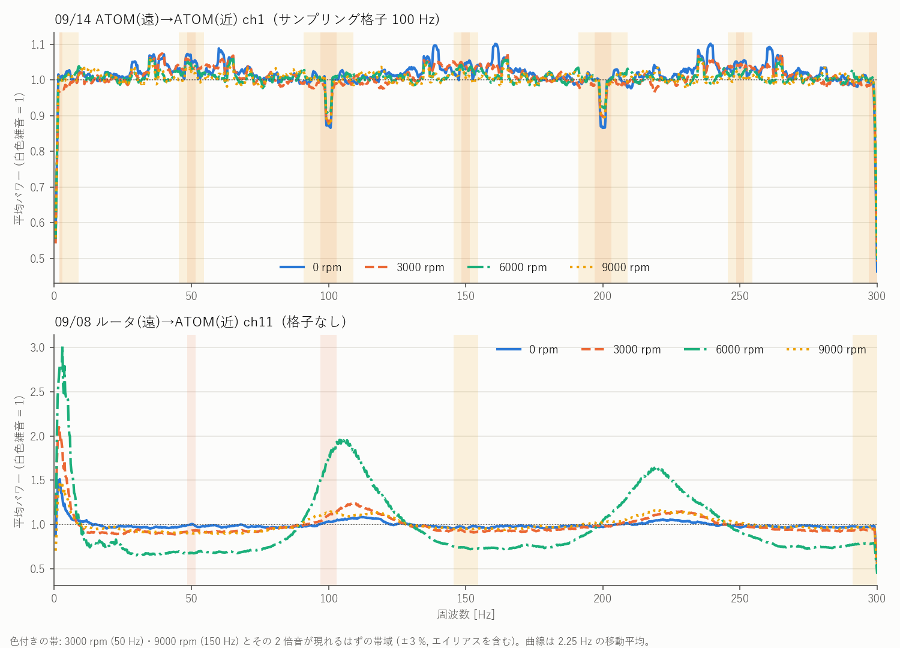
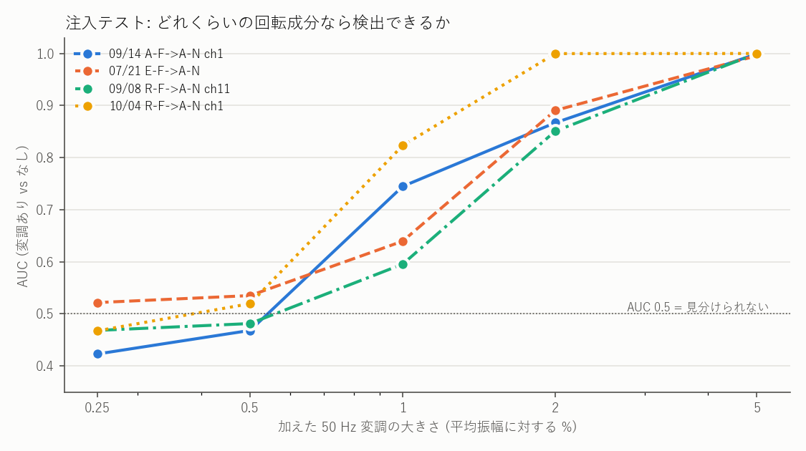

# 回転周波数のスペクトル解析

作成日: 2026-11-22
関連資料: [10月までのデータを加えた追加解析レポート.md](10月までのデータを加えた追加解析レポート.md)（10.2 節で提案した解析を実施したもの）、[フレーム形式検証レポート.md](フレーム形式検証レポート.md)

---

## 1. 目的

[10月までのデータを加えた追加解析レポート.md](10月までのデータを加えた追加解析レポート.md) で、日内評価の高い正解率は測定セッション（時間帯）の違いでもほぼ説明できてしまうことが分かった。セッションの違いでは説明できない、**回転数に物理的に結びついた証拠**があるかを確かめるため、CSI 振幅の時系列のスペクトルに回転周波数の成分が現れているかを調べた。

| 回転数 | 回転周波数（基本） | 2 倍音 |
|---|---|---|
| 3000 rpm | 50 Hz | 100 Hz |
| 6000 rpm | 100 Hz | 200 Hz |
| 9000 rpm | 150 Hz | 300 Hz |

対象は 06/18〜10/28 の 31 条件、全 62,000 ファイル。

## 2. 結論

1. **CSI 振幅のスペクトルに、回転周波数の成分は検出されなかった。** 回転周波数が現れるはずの帯域のパワーを 0 rpm と比べた AUC は、82 通りの検定で中央値 0.51（四分位範囲 0.46〜0.57）だった。帯域をずらした場所と比べて目立って大きかったのは 1 通りだけだった（06/18 の 9000 rpm。この条件は形式の交絡が強い）。
2. **この方法の感度は十分にある。** 0 rpm のファイルに人工的な回転成分を加えると、**平均振幅の 2〜5 % の変調**で検出できた（2 % で AUC 0.82〜1.00、5 % で 0.99〜1.00）。自然な振幅の揺らぎ（6〜11 %）よりずっと小さい。少なくとも「振幅の数 % 以上で、回転周波数で周期的に変わる成分」は CSI に含まれていない。
3. **回転周波数の帯域のパワーだけでは、回転数を識別できない。** 3 次元の帯域パワーで識別すると、日内のランダム分割で平均 33.9 %、日をまたぐと平均 27.6 % だった（偶然なら 25 %）。
4. ルータ条件には **103〜112 Hz 付近（と 220 Hz 付近）の幅の広い成分**があった。ただし、0 rpm（停止中）にも同じ程度の強さで現れる日があり、回転によるものではない。フレーム形式の混ざり方と関係しており、ルータの送信の仕方に由来する可能性が高い（5.3 節）。
5. **ATOM S3 / ESP32-S3 送信では、パケットが 10 ms（または 8 ms）の格子に乗っている。** そのため格子の半分（50 Hz または 62.5 Hz）を超える周波数は折り返される。100 Hz 格子では 3000 rpm と 9000 rpm が同じ 50 Hz に重なり、6000 rpm の 100 Hz は 0 Hz に重なってゆっくりした変化と区別できない。125 Hz 格子では 6000 rpm と 9000 rpm が同じ 25 Hz に重なる（3.2 節）。

**まとめ:** スペクトル解析の結果は、「日内の高精度は回転数ではなくセッションの違いによる」という見方と矛盾しない。少なくとも、回転数の証拠をスペクトルの面から補強することはできなかった。

## 3. 方法

### 3.1 スペクトルの計算（`spectrum.py`）

パケットの受信時刻（`rx_ctrl->timestamp`、µs）は不等間隔なので、等間隔を仮定する FFT は使わず、**受信時刻そのものを使った DFT**（不等間隔 DFT、古典的ピリオドグラム）で計算した。

1. **使うパケット:** ルータ条件は、そのファイルで最も多いフレーム形式のパケットだけを使う。形式が切り替わると振幅が段差状に変わり、広い帯域に偽の成分が出るためである。ATOM / ESP は全パケットを使う。
2. **使う列:** その形式で値がある列（列 0 は除く）。
3. 各列の振幅から平均と線形トレンドを除き、標準偏差で割る。
4. 列ごとに P(f) = |Σₙ x(tₙ) e^{−i2πf tₙ}|² / N を求め、列について平均する。**白色雑音なら期待値は 1** で、1 より大きいほどその周波数の成分が強い。
5. 周波数は 0.5〜300 Hz、0.25 Hz 刻み。1 ファイルの長さは 4〜9 s なので、周波数分解能は 0.1〜0.25 Hz 程度である。

### 3.2 サンプリング格子と折り返し

サンプリング時刻だけで決まるスペクトル窓 W(f) = |Σₙ e^{−i2πf tₙ}|² / N² を調べると、送信機によってはっきり違った。

| 送信機 | 条件 | パケットの間隔 | 格子 | 回転周波数の現れる位置（折り返し後） |
|---|---|---|---|---|
| ATOM S3（6〜7 月） | 06/30×2, 07/03, 07/14, 07/16, 07/20 | 8 ms 前後 | **125 Hz** | 3000 → 50 Hz、6000 → 25 Hz、9000 → 25 Hz |
| ATOM S3（9〜10 月）・ESP32-S3 | 09/14, 09/17, 10/28, 07/06×2, 07/07, 07/21×2, 07/27, 09/24, 09/28 | 10 ms 前後 | **100 Hz** | 3000 → 50 Hz、**6000 → 0 Hz**、9000 → 50 Hz |
| ルータ | 14 条件 | 約 2 ms 間隔のバーストと、その間の休止 | なし | 真の周波数（50 / 100 / 150 Hz）のまま |

- ATOM / ESP の間隔は 0.1〜25 ms とばらつく。それでも受信時刻は格子からほとんどずれず、W(f) は格子周波数で 0.3〜0.8 になる。そのため、格子周波数の整数倍だけずれた周波数どうしは区別できない。
- **100 Hz 格子では、3000 rpm と 9000 rpm が同じ 50 Hz に重なる。6000 rpm は 0 Hz に重なり、ゆっくりしたドリフトと区別できない。** スペクトルで回転数を見分けるには、送信間隔を回転周波数と整数比にならない値にするか、ばらつかせる必要がある。
- ルータはバーストの中で約 450 Hz の瞬間的なレートで受信されるので、折り返しは弱い（W(f) は最大でも 0.2 程度）。

### 3.3 回転周波数の成分があるかの判定（`spectrum_analysis.py`）

1. **期待帯域:** 回転数 r について、基本 f₀ = r/60 と 2 倍音 2f₀ の ±3 % を真の周波数の範囲とする。格子がある条件では、折り返した位置もすべて含める（2 Hz 未満は除く）。
2. **帯域パワー B_r:** ファイルごとに、期待帯域の中のスペクトルの最大値。
3. **AUC:** 回転数 r のクラスと 0 rpm のクラスで B_r の分布を比べる。回転の成分があれば 1 に近づく。
4. **帰無分布:** 期待帯域の集合全体を 5〜45 Hz ずらした 40 通りで同じ AUC を求め、本来の帯域の AUC がその何パーセンタイルかを見る。帯域の位置に意味がなければ、50 前後のどこにでもなる。
5. **識別:** [B₃₀₀₀, B₆₀₀₀, B₉₀₀₀] の 3 次元（対数）だけで 4 クラスを識別する。日内ランダム分割、日内の時間方向の分割、日をまたいだ leave-one-day-out の 3 通り。

100 Hz 格子の条件の 6000 rpm は、期待帯域が 2〜3 Hz（ドリフトの領域）しか残らないので、判定から除いた。判定は 31 条件 × 3 回転数 − 9 = 82 通りである。

### 3.4 感度の確認（`spectrum_injection.py`）

0 rpm のファイル 200 個のうち半分に、各列の振幅へ (1 + α·sin(2πft + φ)) を掛けた（f = 50 Hz または 150 Hz、φ はファイルごとにランダム、t は実際の受信時刻）。変調ありとなしで B の AUC を α ごとに求め、どれだけ小さい変調まで検出できるかを見た。

## 4. 結果

### 4.1 クラス平均スペクトル（代表 2 条件）



- **上（09/14 ATOM、100 Hz 格子）:** 4 クラスともほぼ 1（白色雑音の水準）で、期待帯域（色付き）にピークはない。100 Hz と 200 Hz のくぼみは、格子の整数倍で信号が DC と区別できなくなり、トレンド除去で消されるためである（どのクラスにも同じように出る）。
- **下（09/08 ルータ）:** 6000 rpm のクラスに、105 Hz と 220 Hz 付近の幅の広い山がある。ただし、山の幅は ±15 Hz 程度で、一定の回転による細い線ではない。同じ山は他の日の 0 rpm にも現れる（5.3 節）。6000 rpm のクラスで 10〜100 Hz のパワーが 1 より低いのは、0〜5 Hz のゆっくりした変動が大きく、標準化で他の帯域の割合が下がったためである。

### 4.2 帯域パワーの AUC（82 通り）

| 指標 | 値 |
|---|---|
| AUC の中央値（四分位範囲） | 0.51（0.46〜0.57） |
| AUC ≥ 0.7 | 5 通り |
| AUC ≤ 0.3（0 rpm のほうが大きい） | 5 通り |
| AUC ≥ 0.7 かつ帰無分布の 95 パーセンタイル以上 | **1 通り**（06/18 の 9000 rpm、AUC 0.75） |

- AUC が 0.5 から離れた検定は、上向きと下向きが同じ数あった。また、帯域をずらしても同じくらいの AUC が出るものが多い。これは、回転周波数の線があるのではなく、セッションごとにスペクトル全体の形（ゆっくりした変動の割合）が違うためと考えられる。
- 唯一の該当例 06/18 の 9000 rpm は、全パケットがほぼ WD 形式で、0 rpm（D 形式が中心）と形式が違う条件である（[フレーム形式検証レポート.md](フレーム形式検証レポート.md) 5.1 節）。回転の証拠とはみなせない。
- 条件ごとの値は付録 A の表と `results/spectrum_analysis.json` を参照。

### 4.3 帯域パワーによる識別（%）

| 評価 | 平均 | 範囲 |
|---|---|---|
| 日内ランダム分割 | 33.9 | 24.3〜56.0 |
| 日内の時間方向の分割 | 31.6 | 23.0〜47.2 |
| 日をまたいだ leave-one-day-out（18 通り） | 27.6 | 22.4〜36.6 |

（偶然なら 25 %。振幅の時間平均の 57 次元を使うと、日内ランダム分割で平均 95.2 %）

### 4.4 感度（注入テスト）



| 条件 | 格子 | 自然な揺らぎ（標準偏差 ÷ 平均） | α = 1 % | α = 2 % | α = 5 % |
|---|---|---|---|---|---|
| 09/14 A-F→A-N ch1 | 100 Hz | 5.9 % | 0.74 / 0.70 | 0.87 / 0.88 | 1.00 / 0.99 |
| 07/21 E-F→A-N | 100 Hz | 10.9 % | 0.64 / 0.59 | 0.89 / 0.82 | 1.00 / 1.00 |
| 09/08 R-F→A-N ch11 | なし | 11.4 % | 0.60 / 0.57 | 0.85 / 0.85 | 1.00 / 1.00 |
| 10/04 R-F→A-N ch1 | なし | 7.3 % | 0.82 / 0.87 | 1.00 / 1.00 | 1.00 / 1.00 |

（AUC。「50 Hz / 150 Hz」の順。0.5 で見分けられない）

**平均振幅の 2 % の変調で AUC 0.82〜1.00、5 % でほぼ 1.00** になった。実際のクラスの AUC（中央値 0.51）は、注入テストの α = 0.5 % 以下の水準である。

## 5. 解釈と限界

### 5.1 分かったこと

- 回転する機械が電波の伝わり方を周期的に変えているなら、その周波数（またはその折り返し）に線が現れるはずである。数 % の変調なら検出できる感度があるのに、線は見つからなかった。
- したがって、**今の測定配置では、回転そのものによる CSI の周期的な変化は、少なくとも振幅の数 % より小さい**。日内の高精度（時間平均で約 95 %）は、回転による周期的な変化ではなく、時間平均の形の違い（セッションの違い）によるものと考えるのが自然である。

### 5.2 この解析で否定できないこと

1. ~~回転数が公称値から大きくずれている場合。~~ **回転数はタコメータで測定しており、表記どおり**（研究者の確認, 2026-11-23）。期待帯域（公称値の ±3 %）から外れていた可能性はない。
2. **回転周波数の 3 倍音以上の成分や、羽根の枚数分の周波数（翼通過周波数）。** 2 倍音までしか見ていない。ただし、100 Hz 格子の条件では、50 Hz の倍音はすべて 0 Hz か 50 Hz に折り返されるので、実質的に調べている。
3. **1 ファイル内で回転周波数がふらつく場合。** 線が広がって弱くなる。
4. **振幅以外の情報。** 位相は使っていない。ESP32 の CSI の位相は、CFO・SFO・パケットごとの位相のずれを補正しないと使えないため、今回は扱わなかった。
5. **100 Hz 格子での 6000 rpm。** 原理的に検出できない（3.2 節）。

### 5.3 ルータ条件の 103〜112 Hz 付近の成分について

ルータ条件では、103〜112 Hz 付近（と、その約 2 倍の 220 Hz 付近）に幅の広い山が現れることがある。

| 条件 | 0 rpm | 3000 rpm | 6000 rpm | 9000 rpm |
|---|---|---|---|---|
| 06/18 R-N→A-N | **1.75** | 1.57 | 1.04 | 0.99 |
| 08/03 R-N→A-N | 1.41 | 1.54 | 1.50 | **1.81** |
| 08/06 R-F→A-F | **1.72** | 1.67 | 1.68 | 1.62 |
| 09/08 R-F→A-N ch11 | 1.08 | 1.24 | **1.97** | 1.15 |
| 09/10 R-F→A-N ch11 | 1.15 | 1.02 | **1.95** | 1.01 |
| 10/01 R-F→A-N ch11 | 1.06 | 1.01 | **1.36** | 1.16 |
| 10/04 R-F→A-N ch1 | 1.29 | 1.24 | 1.22 | 1.20 |

（95〜125 Hz のクラス平均スペクトル（2.25 Hz 移動平均）の最大値。白色雑音 = 1）

- **0 rpm（停止中）にも同じ強さで現れる日がある**（06/18、08/06 など）。回転だけでは説明できない。
- ビーコン間隔（102.4 ms、9.77 Hz）の倍音ではない。倍音の位置のパワーは、他の周波数と変わらなかった。
- ファイル内で最も多い形式のパケットの割合が高いファイルほど、山が強い傾向がある（クラス内の順位相関 0.3〜0.5、4 条件中 3 条件）。ルータの送信の仕方（応答フレームの送り方とタイミング）に由来する成分である可能性が高い。ファームウェアの ping の間隔（10 ms = 100 Hz）とも近いが、山の中心は 100 Hz より 3〜12 Hz 高い。
- ch11 の 09/08・09/10・10/01 では、6000 rpm のクラスで最も強い。回転の寄与がまったくないとは言い切れない。しかし、0 rpm にも現れる成分なので、回転の証拠としては使えない。

## 6. 提案

- **回転を確かめる基準を用意する。** 回転計や加速度センサを機械に付けて同時に記録すれば、実際の回転周波数と、その周波数の成分が CSI にあるかを直接照らし合わせられる。
- **送信間隔を見直す。** ATOM / ESP の送信間隔（8 ms・10 ms）は、回転周波数と整数比の関係にあり、3000 rpm と 9000 rpm、6000 rpm と DC が重なる。間隔をランダムにばらつかせるか、回転周波数より十分速いレート（例: 500 Hz 以上）で送れば、回転周波数を直接見られる。
- **機械と送受信機の配置を工夫する。** 回転部が送受信の経路（第 1 フレネルゾーン）に入る配置にすると、回転による変化が大きくなる。
- ルータの 103〜112 Hz の成分の正体を確かめるため、ファームウェアで `sig_mode` などのフレーム情報を記録する（[CSI形式とファームウェア設定の解説.md](CSI形式とファームウェア設定の解説.md) 5 節）。

## 7. 再現手順

`c:\卒業研究\reproduce\` で、[10月までのデータを加えた追加解析レポート.md](10月までのデータを加えた追加解析レポート.md) 11 節の手順のあとに次を実行する。

```
python spectrum.py             # 全ファイルのスペクトル → results/spectrum/*.npz (約 10 分)
python spectrum_analysis.py    # 帯域パワーの AUC・識別 → results/spectrum_analysis.json
python spectrum_injection.py   # 注入テスト → results/spectrum_injection.json
python spectrum_figures.py     # 図 → report/figures/*.png
```

## 付録 A. 条件ごとの結果

| 条件 | 格子 | AUC 3000 / 6000 / 9000 | 帰無分布のパーセンタイル | 識別（ランダム / 時間方向, %） |
|---|---|---|---|---|
| 06/18 R-N→A-N | なし | 0.30 / 0.34 / **0.75** | 0 / 80 / 100 | 41.6 / 41.0 |
| 06/22 R-F→A-N | なし | 0.69 / 0.37 / 0.30 | 100 / 95 / 0 | 38.3 / 36.5 |
| 06/29 R-F→A-F | なし | 0.57 / 0.57 / 0.58 | 75 / 10 / 57 | 29.3 / 26.0 |
| 06/30 A-N→A-N | 125 Hz | 0.71 / 0.75 / 0.57 | 80 / 90 / 85 | 36.3 / 27.0 |
| 06/30 A-F→A-N | 125 Hz | 0.56 / 0.70 / 0.71 | 8 / 100 / 18 | 39.0 / 27.0 |
| 07/03 A-F→A-F | 125 Hz | 0.38 / 0.42 / 0.40 | 0 / 22 / 22 | 32.7 / 30.0 |
| 07/06 E-F→E-N | 100 Hz | 0.53 / — / 0.29 | 72 / — / 0 | 36.2 / 32.5 |
| 07/06 E-N→E-N | 100 Hz | 0.54 / — / 0.50 | 48 / — / 78 | 35.8 / 36.5 |
| 07/07 E-F→E-F | 100 Hz | 0.48 / — / 0.58 | 50 / — / 70 | 47.1 / 44.5 |
| 07/09 R-N→A-N | なし | 0.51 / 0.52 / 0.47 | 42 / 57 / 22 | 24.9 / 26.8 |
| 07/10 R-F→A-N | なし | 0.53 / 0.48 / 0.57 | 50 / 0 / 100 | 26.7 / 26.2 |
| 07/11 R-F→A-F | なし | 0.49 / 0.57 / 0.53 | 10 / 90 / 80 | 30.5 / 25.0 |
| 07/14 A-N→E-N | 125 Hz | 0.54 / 0.55 / 0.54 | 75 / 55 / 8 | 24.5 / 27.0 |
| 07/16 A-F→E-N | 125 Hz | 0.52 / 0.50 / 0.54 | 78 / 65 / 95 | 24.3 / 27.8 |
| 07/20 A-F→E-F | 125 Hz | 0.49 / 0.23 / 0.16 | 52 / 32 / 65 | 39.0 / 37.8 |
| 07/21 E-F→A-N | 100 Hz | 0.70 / — / 0.68 | 55 / — / 75 | 37.4 / 39.0 |
| 07/21 E-N→A-N | 100 Hz | 0.61 / — / 0.34 | 50 / — / 2 | 56.0 / 45.8 |
| 07/27 E-F→A-F | 100 Hz | 0.51 / — / 0.63 | 57 / — / 32 | 34.2 / 31.0 |
| 08/03 R-N→A-N | なし | 0.46 / 0.48 / 0.45 | 18 / 0 / 100 | 26.5 / 23.0 |
| 08/04 R-F→A-N | なし | 0.59 / 0.51 / 0.37 | 82 / 100 / 2 | 30.4 / 31.2 |
| 08/06 R-F→A-F | なし | 0.51 / 0.48 / 0.54 | 50 / 12 / 98 | 28.6 / 28.0 |
| 09/07 R-F→A-N ch11 | なし | 0.50 / 0.50 / 0.48 | 32 / 92 / 42 | 27.6 / 27.0 |
| 09/08 R-F→A-N ch11 | なし | 0.54 / 0.84 / 0.45 | 52 / 92 / 45 | 40.8 / 47.2 |
| 09/10 R-F→A-N ch11 | なし | 0.41 / 0.56 / 0.51 | 0 / 38 / 57 | 36.5 / 33.5 |
| 09/14 A-F→A-N ch1 | 100 Hz | 0.43 / — / 0.39 | 22 / — / 92 | 25.2 / 23.2 |
| 09/17 A-F→A-N ch1 | 100 Hz | 0.43 / — / 0.67 | 30 / — / 78 | 30.8 / 28.7 |
| 09/24 E-F→E-N ch1 | 100 Hz | 0.47 / — / 0.38 | 15 / — / 12 | 35.3 / 25.8 |
| 09/28 E-F→A-N ch1 | 100 Hz | 0.54 / — / 0.26 | 92 / — / 0 | 33.1 / 26.8 |
| 10/01 R-F→A-N ch11 | なし | 0.47 / 0.60 / 0.46 | 0 / 45 / 12 | 30.7 / 30.8 |
| 10/04 R-F→A-N ch1 | なし | 0.51 / 0.52 / 0.51 | 8 / 35 / 15 | 27.1 / 24.5 |
| 10/28 A-F→A-N ch11 | 100 Hz | 0.47 / — / 0.48 | 12 / — / 8 | 46.0 / 43.8 |

（「—」は 100 Hz 格子の 6000 rpm で、0 Hz に重なるため判定から除いたもの。識別は 6000 rpm の帯域パワーも含めた 3 次元で行っている）
